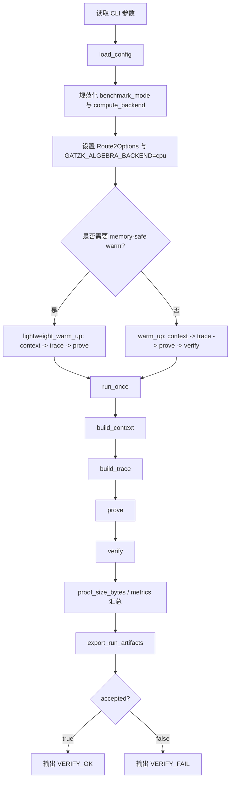

# 项目技术说明：全链路详解

本文档基于当前仓库真实存在的源码、配置、脚本、测试、导出结果与运行产物整理，目标是帮助第一次接触该项目的人，从“这个项目到底做什么”一直理解到“数据如何一路走到 `verify` 成功并导出正式 benchmark 结果”。

本文档只根据当前仓库内容写作，核心依据包括但不限于：

- `README.md`
- `GAT-ZKML-多层多头.md`
- `src/main.cpp`
- `include/gatzk/protocol/*.hpp`
- `src/protocol/*.cpp`
- `include/gatzk/util/config.hpp`
- `src/util/config.cpp`
- `src/data/loader.cpp`
- `src/model/gat.cpp`
- `src/algebra/*.cpp`
- `src/crypto/*.cpp`
- `tests/test_main.cpp`
- `scripts/export_benchmark_table.py`
- `configs/*.cfg`
- `runs/benchmarks/**`
- `runs/*/warm/run_manifest.json`
- `runs/*/cuda_formal/warm/run_manifest.json`
- `runs/tests/*.log`

如果某个结论不是单点代码直接写明，而是由多个位置共同支持，文中会明确写出“这是根据若干源码位置交叉推断出的结论”。如果某点在当前仓库里仍无法完全确认，文中会明确标注“不确定”或“当前仓库中未找到直接证据”。

---

# 1. 项目定位与一句话总结

## 1.1 一句话总结

这是一个把**多层多头 GAT 推理过程**编码为**形式化 trace / polynomial / quotient / opening 证明流程**，并以 **KZG + Fiat-Shamir transcript** 为承诺与验证基础的 `formal proving pipeline`；它提供一个共享单一协议语义的 `full_cpu` 与 `full_gpu` 执行后端，并以全数据集、warm、verified 路径作为正式 benchmark 口径。

对应依据：

- `README.md`
- `GAT-ZKML-多层多头.md`
- `src/main.cpp`
- `include/gatzk/protocol/proof.hpp`
- `src/protocol/prover.cpp`
- `src/protocol/verifier.cpp`

## 1.2 这个项目不是在做什么

根据当前仓库内容，这个项目**不是**以下几类东西：

| 误解 | 当前仓库中的真实情况 | 依据 |
| --- | --- | --- |
| 一个仅演示概念的 toy demo | 仓库包含正式配置、正式 benchmark 导出、正式 manifests、README 与 tests 的一致性约束，且 `main.cpp` 只保留 `warm` 正式主线 | `src/main.cpp`, `tests/test_main.cpp`, `runs/benchmarks/*` |
| 一个训练仓库 | 训练并不是当前仓库 formal 主线的一部分；当前仓库主线从数据缓存与 checkpoint bundle 准备完成后开始 | `README.md`, `scripts/prepare_*.py`, `src/model/gat.cpp` |
| 一个带独立 DSL / 电路文件的 ZKP 框架 | 当前仓库没有看到独立的 circuit DSL 文件；“电路”是通过 `trace + polynomial + lookup + state machine + quotient + opening` 组合表达的 | `GAT-ZKML-多层多头.md`, `src/protocol/trace.cpp`, `src/protocol/quotients.cpp` |
| 两套不同语义的 CPU/GPU 协议实现 | CPU/GPU 共享同一 formal note、同一 transcript 顺序、同一 proof 结构与 verifier 方程；GPU 只改执行策略与热点路由 | `GAT-ZKML-多层多头.md`, `include/gatzk/util/route2.hpp`, `src/main.cpp`, `tests/test_main.cpp` |

## 1.3 当前仓库正式主线的边界

从当前实现看，正式主线边界大致如下：

1. 数据准备脚本负责把原始数据整理成缓存格式。
2. 训练侧或外部流程负责产出 checkpoint bundle。
3. 当前仓库读取配置，加载缓存数据与 checkpoint bundle。
4. 当前仓库构建 `ProtocolContext`。
5. 当前仓库构建 `trace`。
6. 当前仓库执行 `prove`。
7. 当前仓库执行 `verify`。
8. 当前仓库导出 `run_manifest.json`、`benchmark.txt`、挑战信息与 proof 元信息。
9. 当前仓库用 `scripts/export_benchmark_table.py` 聚合正式 benchmark 主表。
10. 当前仓库用 `tests/test_main.cpp` 约束 formal mainline、artifact truth source 和 README 同步。

这意味着：训练是参数来源，但不是这套 formal proving pipeline 的第二条“官方执行主线”。

---

# 2. 仓库总体结构与职责划分

## 2.1 顶层目录功能表

| 目录 | 作用 | 是否属于正式主线 | 说明 |
| --- | --- | --- | --- |
| `src/` | 核心实现代码 | 是 | 包含入口、协议、数据、模型、代数、密码学实现 |
| `include/gatzk/` | 公开头文件与主要数据结构 | 是 | 定义 `ProtocolContext`、`Proof`、`TraceArtifacts`、`AppConfig` 等 |
| `tests/` | 正式约束测试 | 是 | 当前仓库只有 `tests/test_main.cpp`，但覆盖协议、artifact、README、benchmark 一致性 |
| `configs/` | 正式数据集配置 | 是 | 定义 full-dataset warm 主线输入 |
| `scripts/` | 数据准备与 benchmark 聚合脚本 | 是 | `prepare_*` 负责缓存准备，`export_benchmark_table.py` 负责聚合导出 |
| `runs/` | 已生成的运行产物与 benchmark truth source | 是 | 包含 per-run manifest、聚合主表、测试日志 |
| `artifacts/` | checkpoint bundle 等静态输入 | 是 | 当前实际使用的是 `artifacts/checkpoints/*` |
| `data/` | 原始或缓存数据目录 | 是 | `src/data/loader.cpp` 会从这里读取或触发自动准备 |
| `reference/` | 参考实现或参考脚本 | 辅助 | 当前可见 `reference/gat_ogbn_arxiv/pyg_gat_example.py` |
| `cmake/` | 构建辅助 | 是 | 与顶层 `CMakeLists.txt` 配套 |
| `third_party/` | 三方依赖 | 是 | 当前项目依赖 `mcl` 等第三方库 |
| `build/`, `build_cuda/` | 本地构建输出 | 否 | 构建产物，不属于协议本体 |

## 2.2 `src/` 子层级职责

| 路径 | 职责 | 典型文件 |
| --- | --- | --- |
| `src/main.cpp` | 命令行入口、backend 选择、warm-up、单次运行、artifact 导出 | `src/main.cpp` |
| `src/protocol/` | formal proving mainline 核心 | `prover.cpp`, `verifier.cpp`, `trace.cpp`, `challenges.cpp`, `quotients.cpp`, `schema.cpp` |
| `src/data/` | 数据集缓存加载与局部图标准化 | `loader.cpp` |
| `src/model/` | checkpoint bundle 解析、GAT 前向、量化前浮点参考/NOTE 风格前向 | `gat.cpp` |
| `src/algebra/` | 域、FFT、polynomial、barycentric evaluation、GPU 热点求值 | `polynomial.cpp`, `eval_backend.cpp`, `cuda_backend.cu`, `vector_ops.cpp` |
| `src/crypto/` | curve/KZG/transcript/MSM/配对验证 | `curve.cpp`, `kzg.cpp`, `transcript.cpp` |
| `src/util/` | 配置解析、日志、route2 选项 | `config.cpp`, `logging.cpp`, `route2.cpp` |

## 2.3 正式主线与辅助组件的划分

正式主线直接依赖的代码：

- `src/main.cpp`
- `src/protocol/*`
- `src/data/loader.cpp`
- `src/model/gat.cpp`
- `src/algebra/*`
- `src/crypto/*`
- `src/util/config.cpp`
- `configs/*.cfg`
- `scripts/export_benchmark_table.py`
- `runs/*`
- `tests/test_main.cpp`

辅助组件但仍重要：

- `scripts/prepare_planetoid.py`
- `scripts/prepare_ppi.py`
- `scripts/prepare_ogbn_arxiv.py`
- `reference/gat_ogbn_arxiv/pyg_gat_example.py`

---

# 3. 运行入口与总控流程

本项目的正式运行入口是 `src/main.cpp`，执行程序名在 `CMakeLists.txt` 中定义为 `gatzk_run`。

## 3.1 顶层执行流程

`src/main.cpp` 的真实主线可以概括为：

1. 解析命令行参数。
2. 强制 benchmark 模式为 `warm`。
3. 规范化 `compute_backend`，只允许 `cpu` 或 `cuda_hotspots`。
4. 固定环境变量 `GATZK_ALGEBRA_BACKEND=cpu`。
5. 将 `compute_backend` 翻译成 `Route2Options` 中的 GPU 热点开关。
6. 加载配置文件。
7. 先做一次 warm-up。
8. 再执行一次正式 `run_once(...)`。
9. `run_once(...)` 内部依次做 `build_context -> build_trace -> prove -> verify -> export_run_artifacts`。
10. 最终在 stdout 输出 `VERIFY_OK` 或 `VERIFY_FAIL`。

对应代码：

- `src/main.cpp`
- `CMakeLists.txt`

## 3.2 Mermaid 流程图

## 3.3 命令行参数详解

`src/main.cpp` 当前直接解析的参数如下：

| 参数 | 作用 | 代码位置 | 备注 |
| --- | --- | --- | --- |
| `--config` | 指向 `.cfg` 配置文件 | `src/main.cpp` | 必填 |
| `--benchmark-mode` | benchmark 模式 | `src/main.cpp` | 当前 formal mainline 只允许 `warm` |
| `--compute-backend` | 选择 `cpu` 或 `cuda_hotspots` | `src/main.cpp` | 非法值直接报错 |
| `--fast-msm` | Route2 开关 | `src/main.cpp` | 只影响实现路由，不改语义 |
| `--parallel-fft` | Route2 开关 | `src/main.cpp` | 同上 |
| `--fft-backend-upgrade` | Route2 开关 | `src/main.cpp` | 同上 |
| `--fft-kernel-upgrade` | Route2 开关 | `src/main.cpp` | 同上 |
| `--trace-layout-upgrade` | Route2 开关 | `src/main.cpp` | 同上 |
| `--fast-verify-pairing` | Route2 开关 | `src/main.cpp` | 同上 |
| `--export-tag` | 在 `export_dir` 下追加导出子目录 | `src/main.cpp` | 用于如 `cuda_formal` 这样的导出分支 |

## 3.4 为什么 formal mainline 只支持 `warm`

这是当前仓库中写死的正式边界：

- `src/main.cpp` 在参数解析后直接检查：如果 `benchmark_mode != "warm"`，抛出异常 `formal mainline only supports --benchmark-mode warm`
- `scripts/export_benchmark_table.py` 也只接受 `benchmark_mode == "warm"` 的 run manifest 进入正式聚合
- `tests/test_main.cpp` 反复检查所有正式 CPU/GPU manifests 与聚合结果都必须是 `warm`

因此，“只保留 full-dataset warm verified 路径”不是 README 叙述，而是入口、脚本与测试三处共同强制的仓库现实。

## 3.5 `warm_up` 与 `lightweight_warm_up`

`src/main.cpp` 中有两类 warm-up：

| 函数 | 行为 | 适用场景 |
| --- | --- | --- |
| `warm_up(...)` | 执行 `build_context -> build_trace -> prove -> verify` | 普通正式 warm 预热 |
| `lightweight_warm_up(...)` | 执行 `build_context -> build_trace -> prove` | 内存更敏感的场景 |

`memory_safe_warm_required(...)` 目前针对：

- `dataset == "ogbn_arxiv"`
- `batching_rule == "whole_graph_single"`
- `subgraph_rule == "whole_graph"`

这一逻辑说明：当前仓库并没有为 ogbn-arxiv 另外定义一套协议，而只是对 warm-up 的工程执行方式做了调整。

## 3.6 `cpu` 与 `cuda_hotspots` 如何切换

`src/main.cpp` 的处理方式非常关键：

1. 不管用户选什么后端，都先 `setenv("GATZK_ALGEBRA_BACKEND", "cpu")`。
2. 如果 `--compute-backend cuda_hotspots`，则设置：
   - `route2.cuda_trace_hotspots = true`
   - `route2.cuda_field_hotspots = true`
3. 同时检查：
   - `gatzk::algebra::cuda_backend_build_enabled()`
   - `gatzk::algebra::cuda_backend_available()`

这意味着：

- CPU/GPU 的差异不是“换了一套代数语义后端”。
- GPU 当前是**热点路由模式**，仍建立在同一条 formal mainline 上。
- README、manifests 与 tests 中之所以会同时出现：
  - `backend_name = mcl/cuda_hotspots`
  - `algebra_backend_name = cpu`
  
  其原因就在这里。

## 3.7 `metrics` 如何记录

`RunMetrics` 定义在 `include/gatzk/protocol/proof.hpp`，极其细化。`src/main.cpp` 在 `run_once(...)` 中负责：

- 记录上下文构建时间、trace 构建时间、prove/verify 总时间
- 聚合 `lookup_trace_ms`、`hidden_head_trace_ms`、`trace_misc_ms`
- 计算：
  - `commitment_time_ms`
  - `prove_accounted_ms`
  - `prove_accounting_gap_ms`
  - `verify_accounted_ms`
  - `verify_accounting_gap_ms`
- 最终写入 `proof_size_bytes`
- 将全部信息交给 `export_run_artifacts(...)`

这也是为什么 `run_manifest.json` 中有非常细的子项 breakdown。

## 3.8 `VERIFY_OK` / `VERIFY_FAIL` 如何决定

最终状态来自 `accepted = gatzk::protocol::verify(context, proof, &metrics)`。

- `accepted == true` 时输出 `VERIFY_OK`
- `accepted == false` 时输出 `VERIFY_FAIL`

对应代码：

- `src/main.cpp`
- `src/protocol/verifier.cpp`

---

# 4. 配置系统详解

配置的核心结构体是 `include/gatzk/util/config.hpp` 中的 `AppConfig`，解析逻辑在 `src/util/config.cpp`。

## 4.1 配置文件解析规则

`src/util/config.cpp` 的真实解析规则包括：

1. 按行读取 `key = value`
2. 去除 `#` 注释
3. 去除首尾空白
4. 支持：
   - 布尔值：`true/1/yes`
   - 数组：`[a,b,c]` 或用逗号/分号分隔
   - `hidden_profile` 形式如 `8x8`
5. 禁止 legacy 字段：
   - `hidden_heads`
   - `checkpoint_dir`
6. 对不在支持列表中的字段直接报错

也就是说，这不是一个“宽松”的配置系统；当前 formal mainline 对配置字段有明确边界。

## 4.2 配置合法性校验

`validate_config(...)` 会额外强制：

| 规则 | 含义 | 依据 |
| --- | --- | --- |
| `subgraph_rule` 必须是 `whole_graph` | 正式主线不接受其他子图规则 | `src/util/config.cpp` |
| `hidden_profile` 必须显式给出 | 多层多头形状是形式语义的一部分 | `src/util/config.cpp` |
| `L >= 2` | 当前 formal family 至少两层注意力层 | `src/util/config.cpp` |
| `L == hidden_profile.size() + 1` | 隐藏层数与总 attentional layer 数一致 | `src/util/config.cpp` |
| `d_in_profile.size() == hidden_profile.size()` | 每个隐藏层必须有对应输入维度链 | `src/util/config.cpp` |
| `K_out >= 1` | 输出头至少一个 | `src/util/config.cpp` |
| `num_classes >= 1` | 输出类别数必须存在 | `src/util/config.cpp` |
| 相邻层维度链必须闭合 | 前一层 concat 宽度必须等于下一层输入维度 | `src/util/config.cpp` |

## 4.3 `AppConfig` 关键字段分层解释

### 4.3.1 数据与目录相关

| 字段 | 作用 | 影响阶段 |
| --- | --- | --- |
| `dataset` | 数据集标识，如 `cora`、`ppi`、`ogbn_arxiv` | 数据加载、导出目录、metadata |
| `data_root` | 原始数据根目录 | 数据准备脚本、loader |
| `cache_root` | 预处理缓存根目录 | `load_dataset` |
| `export_dir` | 运行输出目录 | `export_run_artifacts` |
| `checkpoint_bundle` | checkpoint bundle 路径 | 模型参数加载、metadata |
| `reference_output_dir` | 参考输出目录 | 当前仓库中有字段，但不是本文主线中的核心路径 |

### 4.3.2 任务与图组织相关

| 字段 | 作用 | 影响阶段 |
| --- | --- | --- |
| `task_type` | 任务类型，如 transductive 或 inductive multi-graph | `PublicMetadata`, README, manifests |
| `report_unit` | 统计单位，如 `node` 或 `graph` | `PublicMetadata`, artifacts |
| `batching_rule` | 批处理规则，如 `whole_graph_single` / `multi_graph_batch` | `normalize_graph_input`, metadata |
| `subgraph_rule` | 子图规则，当前只支持 `whole_graph` | 配置校验 |
| `self_loop_rule` | 自环规则 | metadata, 图标准化语义 |
| `edge_sort_rule` | 边排序规则 | `normalize_graph_input`, metadata |
| `chunking_rule` | 分块规则 | metadata |
| `batch_graphs` | 多图批处理时取多少图 | `selected_graph_ids(...)` |

### 4.3.3 模型与 formal family 相关

| 字段 | 作用 | 影响阶段 |
| --- | --- | --- |
| `L` / `layer_count` | attentional layer 总数 | `ProtocolContext`, metadata, model shape 校验 |
| `hidden_profile` | 每个隐藏层的 `head_count x head_dim` | formal family 形状 |
| `d_in_profile` | 每个隐藏层输入维度链 | formal family 形状 |
| `K_out` | 输出层头数 | formal family 形状 |
| `num_classes` | 输出类别数 `C` | output layer、metadata |
| `hidden_dim` | 旧简化写法的兼容入口；若给出则可退化成单层 profile | `src/util/config.cpp` |

### 4.3.4 协议与可追溯 ID 相关

| 字段 | 作用 | 影响阶段 |
| --- | --- | --- |
| `quant_cfg_id` | 量化配置 ID | metadata、artifact contract |
| `model_arch_id` | 模型结构 ID | metadata、artifact contract |
| `model_param_id` | 模型参数 ID | metadata、artifact contract |
| `static_table_id` | 静态查表 ID | metadata、artifact contract |
| `degree_bound_id` | 度界 ID | metadata、artifact contract |
| `range_bits` | range table 大小相关 | static tables |
| `seed` | KZG setup seed 等 | `KZG::setup` |

### 4.3.5 工程行为相关

| 字段 | 作用 | 影响阶段 |
| --- | --- | --- |
| `allow_synthetic_model` | 允许不用 checkpoint bundle 而构造 synthetic model | `build_context` |
| `dump_trace` | 是否保留更多 trace payload | `build_trace` |
| `auto_prepare_dataset` | 缓存不存在时是否自动调用准备脚本 | `load_dataset` |
| `symmetrize_edges` | 是否对边做对称化 | `normalize_graph_input` |
| `deduplicate_edges` | 是否去重边 | `normalize_graph_input` |

## 4.4 正式配置文件的真实内容

当前仓库中的正式配置包括：

- `configs/cora_full.cfg`
- `configs/citeseer_full.cfg`
- `configs/pubmed_full.cfg`
- `configs/ppi_batch_formal.cfg`
- `configs/ogbn_arxiv_full.cfg`

其核心差异可以概括为：

| 配置 | dataset | batching_rule | `hidden_profile` | `d_in_profile` | `K_out` | `L` | `num_classes` |
| --- | --- | --- | --- | --- | --- | --- | --- |
| `cora_full.cfg` | `cora` | `whole_graph_single` | `8x8` | `1433` | `1` | `2` | `7` |
| `citeseer_full.cfg` | `citeseer` | `whole_graph_single` | `8x8` | `3703` | `1` | `2` | `6` |
| `pubmed_full.cfg` | `pubmed` | `whole_graph_single` | `8x8` | `500` | `1` | `2` | `3` |
| `ppi_batch_formal.cfg` | `ppi` | `multi_graph_batch` | `1x8` | `50` | `1` | `2` | `121` |
| `ogbn_arxiv_full.cfg` | `ogbn_arxiv` | `whole_graph_single` | `1x8` | `128` | `1` | `2` | `40` |

需要注意：

- PPI 是多图批处理正式路径，不是 whole-graph single。
- 其余四个正式数据集是 whole-graph single。
- `checkpoint_bundle` 都指向 `artifacts/checkpoints/*`。

## 4.5 为什么 formal 主线只保留 full-dataset warm

这件事由多层约束共同形成：

1. `src/main.cpp` 只允许 `--benchmark-mode warm`
2. `run_once(...)` 会检查 `metrics.is_full_dataset`，若不是 full dataset 直接抛错
3. `scripts/export_benchmark_table.py` 只聚合：
   - `benchmark_mode == warm`
   - `is_full_dataset == true`
   - `verified == true`
4. `tests/test_main.cpp` 要求正式 CPU/GPU manifests 和 benchmark tables 都保持 full-dataset warm verified

因此这不是“README 偏好”，而是仓库正式边界。

---

# 5. 数据与模型参数如何进入系统

## 5.1 数据集从哪里来

数据加载从 `src/data/loader.cpp` 开始，主入口是：

- `GraphDataset load_dataset(const util::AppConfig& config)`
- `LocalGraph normalize_graph_input(const GraphDataset& dataset, const util::AppConfig& config)`

`load_dataset(...)` 的逻辑是：

1. 根据 `config.dataset` 决定 cache 路径。
2. 若缓存缺失且 `auto_prepare_dataset=true`，自动调用：
   - `scripts/prepare_planetoid.py`
   - `scripts/prepare_ppi.py`
   - `scripts/prepare_ogbn_arxiv.py`
3. 从缓存目录读取：
   - `meta.cfg`
   - `features.txt` 或 `features.npy`
   - `labels.txt`
   - `edges.txt`
   - 可选 `node_ptr.txt`

## 5.2 `GraphDataset` 与 `LocalGraph`

相关结构定义在 `include/gatzk/data/dataset.hpp`。

| 结构 | 作用 | 关键字段 |
| --- | --- | --- |
| `GraphDataset` | 全数据集级别缓存对象 | `name`, `num_nodes`, `num_features`, `num_classes`, `features_fp`, `features`, `labels`, `edges`, `graph_count`, `node_ptr`, `edge_ptr`, `task_type`, `report_unit` |
| `LocalGraph` | 当前 proving run 实际使用的图输入 | `absolute_ids`, `features_fp`, `features`, `labels`, `edges`, `public_input`, `graph_count`, `node_ptr`, `edge_ptr`, 以及 batching/subgraph/self_loop/edge_sort/chunking 规则字符串 |

这里的 `LocalGraph` 不是一定更小的子图；在正式主线下，它必须是 full dataset，只是“本次证明的标准化图输入表示”。

## 5.3 特征是如何进入字段域的

`src/data/loader.cpp` 中的流程是：

1. 先读原始特征为浮点矩阵。
2. 对每一行做 `row_normalize(...)`。
3. 用固定比例 `16` 量化到 `FieldElement`：
   - `quantize(double value)` 内部做 `value * 16` 的四舍五入

因此：

- `features_fp` 是浮点视图，用于模型前向参考计算。
- `features` 是域元素版本，用于 formal trace / public polynomial / witness 侧。

## 5.4 图结构是如何标准化的

`normalize_graph_input(...)` 的职责是把 `GraphDataset` 转成 formal mainline 需要的统一图表示：

1. 选择 batch graph ids：
   - `selected_graph_ids(...)`
2. 填充局部特征、标签与 `absolute_ids`
3. 维护 `global_to_local` 映射
4. 读入并重写边：
   - 支持 `symmetrize_edges`
   - 支持 `deduplicate_edges`
5. 无论输入数据是否显式有自环，最后都会给每个节点补一个自环边
6. 按规则稳定排序：
   - 先 `graph_id`
   - 再 `dst`
   - 再 `stable_index`
7. 生成 `NormalizedGraphInput public_input`

这一步非常关键，因为：

- 形式语义中的边顺序、目标节点分组、图边界都依赖这里的标准化输出。
- 后续 `P_src`、`P_dst`、`P_Q_new_edge`、`P_Q_end_edge` 等 public objects 都建立在它之上。

## 5.5 checkpoint bundle 如何进入系统

模型参数入口在 `src/model/gat.cpp`：

- `inspect_checkpoint_bundle(...)`
- `checkpoint_bundle_matches_formal_proof_shape(...)`
- `load_checkpoint_bundle_parameters(...)`

真实流程是：

1. 读取 `manifest.json`
2. 提取：
   - `family_schema_version`
   - `output_average_rule`
   - `model_arch_id`
   - `model_param_id`
   - `quant_cfg_id`
   - `static_table_id`
   - `degree_bound_id`
   - `L`
   - `K_out`
   - `C`
   - `d_in_profile`
   - `hidden_layers`
   - `hidden_head_specs`
   - `output_head_specs`
3. 校验 manifest 是否符合当前 formal proof 所需 family shape
4. 读取 `tensors.txt`
5. 按 manifest 中的 tensor 名称重建各 attention head 参数
6. 组装成 `ModelParameters`

## 5.6 checkpoint bundle 校验在约束什么

`checkpoint_bundle_matches_formal_proof_shape(...)` 检查的不是“文件能不能读”，而是“参数族是否符合当前 formal family 约束”，包括：

- `L >= 2`
- `output_average_rule == per_head_bias_then_arithmetic_mean`
- `hidden_layers` 非空
- `hidden_profile` 非空
- `K_out > 0`
- `output_head_specs.size() == K_out`
- `d_in_profile` 与 `hidden_profile` 尺寸链一致
- `model_arch_id/model_param_id/quant_cfg_id` 非空
- 隐藏层 `layer_index` 连续
- `global_head_index` 连续

这意味着：checkpoint bundle 不只是工程输入，也是 formal family shape 的一部分。

## 5.7 模型参数如何进入 `ProtocolContext`

`src/protocol/prover.cpp` 的 `build_context(...)` 会根据配置决定：

- 若 `allow_synthetic_model = true`，则使用 synthetic family model
- 否则必须有 `checkpoint_bundle`，并调用 `model::load_checkpoint_bundle_parameters(...)`

然后还会进一步检查当前 `ModelParameters` 是否支持当前 formal mainline：

- `model::supports_current_formal_proof_shape(...)`
- `model::hidden_family_dimension_chain_is_valid(...)`

因此，模型参数不是在 prove 之后才“顺带使用”，而是在 context 构建阶段就被协议形状严格校验。

## 5.8 `PublicMetadata` 如何来自配置、数据与模型

`PublicMetadata` 的组装在 `src/protocol/challenges.cpp` 的 `canonical_public_metadata(...)` 中完成。它综合了：

- 配置侧：
  - `dataset`, `task_type`, `report_unit`
  - `batching_rule`, `subgraph_rule`, `self_loop_rule`, `edge_sort_rule`, `chunking_rule`
  - `model_arch_id`, `model_param_id`, `static_table_id`, `quant_cfg_id`, `degree_bound_id`
- 数据侧：
  - `graph_count`
  - `N`, `E`
- 模型侧：
  - `L`, `hidden_profile`, `d_in_profile`, `K_out`, `C`
- 域与维度侧：
  - `domain_cfg`
  - `dim_cfg`
- 编码约束侧：
  - `protocol_id = gatzkml`
  - `encoding_id = project-fixed-order-v1`
  - `padding_rule_id = zero-pad+selector-mask`

`PublicMetadata` 不是 README 风格摘要，而是 transcript 吸收与 verifier 校验的一部分。

---

# 6. `ProtocolContext` 详解

`ProtocolContext` 定义在 `include/gatzk/protocol/proof.hpp`，是 prove / verify 之前的统一上下文。

## 6.1 结构字段总览

| 字段 | 类型/来源 | 作用 | 更偏静态还是运行时 |
| --- | --- | --- | --- |
| `config` | `AppConfig` | 原始配置与形式 ID 来源 | 静态 |
| `dataset` | `GraphDataset` | 全数据集缓存对象 | 静态输入 |
| `local` | `LocalGraph` | 当前 run 的标准化图输入 | 运行时输入 |
| `model` | `ModelParameters` | 多层多头 GAT 参数族 | 静态输入 |
| `tables` | `StaticTables` | `range/lrelu/elu/exp` 静态查表 | 静态 |
| `domains` | `WorkDomains` | `FH/edge/in/d_h/cat/C/N` 工作域 | 静态 |
| `kzg` | `crypto::KZG` | KZG setup 与 `tau` | 静态 |
| `public_polynomials` | `map<string, Polynomial>` | 公共多项式对象 | 静态/公共 |
| `public_commitments` | `map<string, Commitment>` | 对公共多项式的承诺 | 静态/公共 |
| `static_commitments` | `map<string, Commitment>` | 对静态表与模型参数的承诺 | 静态/公共 |

## 6.2 为什么 `ProtocolContext` 是 prove / verify 的必要前置条件

从 `src/protocol/prover.cpp` 与 `src/protocol/verifier.cpp` 看，后续 prove / verify 共同依赖它来获得：

1. 当前数据集与局部图的公共结构。
2. 当前 formal family 形状与模型参数。
3. 七个工作域。
4. 静态表。
5. KZG setup。
6. 所有 public/static commitments。
7. 由 metadata 派生的 canonical public profile。

如果没有这个对象：

- prover 无法构造 trace 的 domain、public helper polynomials 与静态承诺。
- verifier 无法重建 metadata、重放 transcript、求值 public polynomial、检查 quotient 方程。

## 6.3 `build_context(...)` 真正做了什么

`src/protocol/prover.cpp` 中的 `build_context(...)` 实际做了以下几类工作。

### 6.3.1 加载输入对象

- `data::load_dataset(config)`
- `data::normalize_graph_input(dataset, config)`
- `model::load_checkpoint_bundle_parameters(...)` 或 synthetic model

### 6.3.2 校验 formal family

- 模型是否为当前 formal mainline 支持的多层多头 family
- 维度链是否闭合
- checkpoint manifest 中的各 ID 是否与配置兼容

### 6.3.3 准备 KZG

- `crypto::KZG::setup(config.seed)`

当前仓库中的 KZG 是一个工程实现对象，不是外部服务。

### 6.3.4 构造七个工作域

`WorkDomains` 当前包含：

| 域名 | 用途大意 | 代码线索 |
| --- | --- | --- |
| `fh` | feature/lookup 相关大域 | `src/protocol/prover.cpp`, `GAT-ZKML-多层多头.md` |
| `edge` | 边域 | 同上 |
| `in` | 输入维度或投影绑定域 | 同上 |
| `d` / `d_h` | 隐层 head 维度域 | 代码中 legacy 与 multihead 写法存在命名差异 |
| `cat` | concat 域 | 同上 |
| `c` / `C` | 类别域 | 同上 |
| `n` / `N` | 节点域 | 同上 |

需要注意：

- formal note 更明确写的是 `FH / edge / in / d_h / cat / C / N`
- 源码某些 legacy 路径中仍有 `d` / `c` / `n` 形式
- 从当前正式 multihead 主线看，更应以 `d_h / C / N` 为主

这是根据 `GAT-ZKML-多层多头.md`、`src/protocol/challenges.cpp`、`src/protocol/prover.cpp`、`src/protocol/verifier.cpp` 交叉推断出的结论。

### 6.3.5 构造静态查表

`StaticTables` 包含：

- `range`
- `exp_x`
- `exp_y`
- `lrelu_x`
- `lrelu_y`
- `elu_x`
- `elu_y`

这些表随后会被编码为公共或静态承诺对象，并参与 lookup / quotient 约束。

### 6.3.6 构造公共多项式与公共承诺

`build_context(...)` 会创建一批与图结构、selector 和 lookup helper 相关的 public polynomial，例如：

- `P_I`
- `P_src`
- `P_dst`
- `P_Q_new_edge`
- `P_Q_end_edge`
- `P_Q_edge_valid`
- `P_Q_N`
- `P_Q_proj_valid`
- `P_Q_d_valid`
- `P_Q_cat_valid`
- `P_Q_C_valid`
- `P_Q_tbl_feat`
- `P_Q_qry_feat`
- `P_Row_feat_tbl`
- `P_Col_feat_tbl`
- `P_Row_feat_qry`
- `P_Col_feat_qry`
- `P_I_feat_qry`

这些对象的共同特点是：

- 它们不是 prover 私有 witness。
- 它们表达的是公共图结构、padding/selector 规则、查表辅助编码。
- verifier 需要重新求值或使用其承诺。

### 6.3.7 构造静态承诺

`static_commitments` 中会包含：

- 特征表承诺 `V_T_H`
- 各类静态表承诺：
  - `V_T_L_x`
  - `V_T_L_y`
  - `V_T_ELU_x`
  - `V_T_ELU_y`
  - `V_T_exp_x`
  - `V_T_exp_y`
  - `V_T_range`
- 模型参数承诺：
  - 多头隐藏层每个 head 的权重与注意力向量
  - 输出层每个 head 的权重与注意力向量

这说明：模型参数在协议里不是“仅用于本地前向”，而是明确进入了承诺体系。

## 6.4 哪些属于静态上下文，哪些属于运行时上下文

### 更偏静态

- `config`
- `model`
- `tables`
- `domains`
- `kzg`
- `public_polynomials`
- `public_commitments`
- `static_commitments`

### 更偏运行时

- `dataset`
- `local`

但要强调，`dataset/local` 虽然是运行时载入的输入，它们一旦进入 `PublicMetadata` 与 public polynomials，就不再只是工程层细节，而成为 formal contract 的一部分。

---

# 7. `trace / witness / polynomial` 体系详解

这一章是理解项目“电路到底怎么表达”的核心。

## 7.1 `TraceArtifacts` 字段总览

`TraceArtifacts` 定义在 `include/gatzk/protocol/proof.hpp`。

| 字段 | 含义 | 作用 |
| --- | --- | --- |
| `columns` | 一维列对象 | 导出或调试用的细粒度列视图 |
| `matrices` | 二维矩阵对象 | 更贴近前向结果的中间张量 |
| `polynomials` | 常驻内存的多项式对象 | 承诺、opening、quotient 求值直接使用 |
| `spilled_polynomials` | 溢写或压缩保存的多项式对象 | 降低内存占用 |
| `polynomial_domains` | 每个 polynomial 所属域名 | verifier / artifacts 可追溯性 |
| `commitments` | 动态承诺标签到 commitment 的映射 | 后续证明输入 |
| `commitment_order` | 动态 commitment 的正式顺序 | transcript 与 proof 契约的一部分 |
| `challenges` | Fiat-Shamir 挑战值 | prove / verify 共享 |
| `external_evaluations` | 外点求值结果 | external folded opening 输入 |
| `witness_scalars` | 额外 witness 标量 | 某些 quotient 与 route 约束需要 |

## 7.2 `trace` 在这个项目里到底是什么

当前仓库中的 `trace` 不是单纯的一张表，而是一个多层次对象：

1. 前向产生的节点/边级矩阵与向量。
2. 为 lookup / route / state machine / binding 约束补充的辅助列。
3. 将这些列按工作域编码为 evaluation-basis polynomial。
4. 对每个动态 polynomial 进行 KZG 承诺。
5. 附带必要的外点求值和 witness 标量。

也就是说，这里的 `trace` 更像：

- 一组按域组织的 witness 载体
- 一组已承诺的动态对象
- 一组为 quotient 和 openings 服务的中间层

## 7.3 `build_trace(...)` 的主分支

`src/protocol/trace.cpp` 的 `build_trace(...)` 会优先判断：

- 如果 `context.model.has_real_multihead == true`，走 `build_multihead_trace(...)`
- 否则走 legacy 路径

当前正式配置都绑定 checkpoint bundle，因此正式主线更接近 multihead family 路径。

## 7.4 `build_multihead_trace(...)` 的真实骨架

从 `src/protocol/trace.cpp` 可见，multihead 主线大致顺序为：

1. 吸收 public metadata 与初始 public/static commitments。
2. 构造 feature lookup 相关 trace。
3. 取 `cached_forward_artifacts(...)`，内部调用 `model::forward_note_style(...)`。
4. 对每个隐藏 head 构造：
   - 投影相关对象
   - 源/目标注意力相关对象
   - softmax 稳定化链条
   - route / max / PSQ / ELU / lookup / binding 辅助对象
5. 对每个隐藏层构造 concat 相关对象。
6. 对输出层各 head 构造输出相关对象。
7. 收集 `external_evaluations` 与 `witness_scalars`。
8. 通过 `dynamic_commitment_labels(context)` 固定动态 commitment 顺序。
9. 用 `replay_challenges(...)` 重建并对齐挑战顺序。

## 7.5 前向结果如何变成 witness

`cached_forward_artifacts(...)` 会调用 `model::forward_note_style(...)`。这说明正式主线下，trace 的数学来源更贴近 formal note，而不是 `forward_reference_style(...)`。

`forward_note_style(...)` 的骨架是：

1. 对每个隐藏层的每个 head：
   - 投影
   - 注意力分数
   - softmax 归一化
   - 聚合
   - 激活
2. 将隐藏层多个 head 的输出做列拼接 concat
3. 输出层各 head 先各自产生输出，再做平均

但 trace 并不只保留最终前向张量，而是把大量中间量显式物化出来。

## 7.6 隐层 head 中间量是如何被展开的

根据 `src/model/gat.cpp` 与 `src/protocol/trace.cpp`，一个隐藏 head 至少涉及以下语义对象：

| 对象 | 语义 |
| --- | --- |
| `H_prime` | 特征投影后结果 |
| `E_src`, `E_dst` | 源/目标注意力线性项 |
| `S` | 注意力打分原值 |
| `Z` | LeakyReLU 后打分 |
| `M` | softmax 稳定化 max |
| `Delta` | `M - Z` |
| `U` | `exp(Z - M)` |
| `Sum` | softmax 分母求和 |
| `inv` | 分母倒数 |
| `alpha` | 归一化注意力权重 |
| `H_agg_pre_bias` / `H_agg_pre_star` | 聚合但未加偏置 / 压缩视图 |
| `H_agg` / `H_agg_star` | 聚合结果 / 压缩视图 |

这些对象中的一部分出现在：

- `matrices`
- `columns`
- `polynomials`
- `external_evaluations`

## 7.7 输出层中间量是如何被展开的

输出层的结构与隐藏层相似，但差异在于：

- 输出头最终指向类别维度 `C`
- 多输出头时存在每个 head 的 `Y_lin` / `Y`
- 最后还有全局平均后的：
  - `P_Y_lin`
  - `P_Y`

`src/protocol/challenges.cpp` 与 `src/protocol/prover.cpp` 都体现了这一点。

## 7.8 `witness` 是如何被组织和物化的

当前仓库里的 witness 并不是单独一个 `Witness` 结构体，而是分散在多个层级中：

1. 浮点前向中间量：`MultiHeadForwardTrace`
2. 量化后的矩阵/向量：`Matrix`、`FieldElement` 列
3. 按域排列后的多项式：`trace.polynomials`
4. 附加的 route / state-machine 标量：`trace.witness_scalars`
5. 外点求值列表：`trace.external_evaluations`

因此，“witness”在这个项目里更像一个**由 trace 物化出来的承诺前对象全集**，而不是单个统一 class。

## 7.9 为什么要从矩阵/列转到 `polynomial`

因为当前证明系统不是直接在矩阵上做证明，而是：

1. 先把 witness 对象排布到某个工作域上。
2. 再编码成 evaluation-basis polynomial。
3. 对 polynomial 做 KZG commitment。
4. 后续的 quotient 检查与 opening 验证也都在 polynomial/evaluation 语义下进行。

因此矩阵/列是“近模型视角”的表示，而 polynomial 是“近 PCS / verifier 视角”的表示。

## 7.10 `TraceArtifacts` 里的各类容器分别适合承载什么

| 容器 | 更像什么 | 典型用途 |
| --- | --- | --- |
| `columns` | 列视图 | 小维度或调试导出 |
| `matrices` | 张量视图 | 更接近 GAT 前向结果 |
| `polynomials` | 协议主对象 | commit/open/quotient |
| `spilled_polynomials` | 内存优化后对象 | 大对象溢写与轻量保存 |
| `commitments` | 承诺结果 | transcript / proof |
| `external_evaluations` | 外点求值 | folded external opening |
| `witness_scalars` | 额外 witness 标量 | quotient 的非整列输入 |

## 7.11 哪些 trace 对应 hidden layer / output layer / lookup / route / state machine / public poly

### hidden layer / output layer

主要位于：

- `src/model/gat.cpp`
- `src/protocol/trace.cpp`

包含：

- 投影
- 注意力
- softmax 链
- 聚合
- concat
- 输出平均

### lookup

相关对象包括：

- `P_Table_feat`
- `P_Query_feat`
- `P_R_feat`
- `P_Q_tbl_*`
- `P_Q_qry_*`
- 各静态表 `P_T_*`

主要在：

- `src/protocol/trace.cpp`
- `src/protocol/quotients.cpp`

### route / state machine

从当前源码看，至少包括：

- `max` 相关状态机
- `PSQ` 状态机
- 各种 route 辅助对象
- `S_src_*`, `S_dst_*`, `S_t_*` 等 witness scalars

主要依据：

- `src/protocol/trace.cpp`
- `src/protocol/quotients.cpp`
- `src/protocol/verifier.cpp`

### public poly

主要由 `build_context(...)` 创建，承载：

- 图结构
- selector
- 查表辅助列
- padding/有效位掩码

## 7.12 这个项目中的“电路”如何体现

这是本文最重要的结论之一。

### 7.12.1 当前仓库没有看到独立的 circuit DSL 文件

当前仓库中未找到类似：

- 单独的 R1CS 文件
- 明确的电路 DSL 源文件
- 单独的 constraint system schema 文件

因此，这个项目里的“电路”**不是**以显式 DSL 文件形式出现。

### 7.12.2 电路的等价实现方式

从 `GAT-ZKML-多层多头.md` 与 `src/protocol/*` 综合看，这个项目里的“电路”等价体现在以下对象组合中：

1. **工作域划分**
   - `FH / edge / in / d_h / cat / C / N`
2. **trace 列/矩阵**
   - 把 GAT 前向中间量显式物化
3. **公共 selector 与 helper polynomial**
   - 指定哪些位置有效、哪些位置是 padding、哪些位置代表新边/末边/某维度有效
4. **lookup 约束**
   - `range / exp / lrelu / elu / feature-table` 等
5. **state machine 约束**
   - softmax 稳定化、PSQ、max 等
6. **binding trace**
   - 通过 `a / b / Acc` 类列把矩阵-向量关系编码进证明对象
7. **quotient 多项式**
   - 将所有局部约束聚合为域上的全局检验式
8. **domain openings**
   - 证明这些 polynomial 在挑战点上满足约束
9. **external folded openings**
   - 处理不在统一工作域上的外点评价

### 7.12.3 为什么这可以视作“电路”

如果把“电路”理解为“需要被证明满足的一组约束系统”，那么当前项目的约束系统不是以 gate DSL 写出，而是被分解进：

- trace 组织
- polynomial 编码
- quotient 公式
- lookup/state-machine/binding 子结构

因此更准确的表述是：

> 这个项目中的“电路”不是单独文件，而是被 formal note 规定，并在 `trace.cpp + quotients.cpp + challenges.cpp + verifier.cpp` 中以多域、多对象、多约束的方式实现。

---

# 8. 证明系统详解

## 8.1 应该如何准确描述这套证明系统

只基于当前仓库证据，较稳妥的描述是：

> 这是一个由 `GAT-ZKML-多层多头.md` 定义语义、以 KZG polynomial commitments 为承诺层、以 Fiat-Shamir transcript 派生挑战、以多域 quotient identity 和 batched openings 为验证机制的自定义 formal proving flow。

需要避免的说法：

- “这就是某个现成标准协议的直接实现”
- “只因为用了 KZG，所以整个系统一定是某个熟知协议的变体”

当前仓库中**没有直接证据**支持把它武断贴为某个标准框架名称。

## 8.2 `Proof` 结构总览

`Proof` 定义在 `include/gatzk/protocol/proof.hpp`。

| 字段 | 作用 | 更偏 public / witness / 承诺 |
| --- | --- | --- |
| `public_metadata` | 公共协议元信息 | public |
| `block_order` | proof 顶层块顺序 | public contract |
| `dynamic_commitments` | 动态 witness 多项式承诺 | 承诺 |
| `quotient_commitments` | quotient 多项式承诺 | 承诺 |
| `domain_openings` | 各工作域 opening bundle | 证明对象 |
| `external_evaluations` | 外点评估值 | witness 派生结果 |
| `witness_scalars` | 额外 witness 标量 | witness |
| `external_witness` | external fold opening witness | 证明对象 |
| `challenges` | transcript 重放得到的挑战集 | public contract |

## 8.3 `public_metadata`

它不仅用于导出，更直接参与：

- transcript 吸收：`src/protocol/challenges.cpp`
- verifier equality check：`src/protocol/verifier.cpp`

如果 `proof.public_metadata != build_public_metadata(context)`，verifier 直接失败。

## 8.4 `block_order`

`src/protocol/schema.cpp` 中 `proof_block_order()` 给出的固定顺序是：

1. `M_pub`
2. `Com_dyn`
3. `S_route`
4. `Eval_ext`
5. `Eval_dom`
6. `Com_quot`
7. `Open_dom`
8. `W_ext`
9. `Pi_bind`

verifier 会要求 `proof.block_order == proof_block_order()`。

### 关于 `Pi_bind` 的重要说明

当前仓库中的 `Proof` 结构体**没有独立字段**显式命名为 `Pi_bind`。但：

- `proof_block_order()` 保留了 `Pi_bind`
- `trace.cpp` 中大量存在 `BindingTrace`
- `quotients.cpp` 中存在多处 `*_bind_*` 约束项

因此较稳妥的结论是：

> 当前实现明确保留了 binding 相关语义与 proof 顶层块顺序中的 `Pi_bind` 位置，但 `Proof` 结构体没有单独暴露一个名为 `Pi_bind` 的独立成员。当前仓库中未找到直接证据，证明它是否被折叠进其他字段、是否由动态承诺与 quotient 共同代表，或是否只是保留了块顺序占位。

这属于“该点仍待进一步确认”的范围。

## 8.5 `dynamic_commitments`

动态承诺顺序由 `src/protocol/challenges.cpp` 中的 `dynamic_commitment_labels(context)` 唯一决定。

这一步非常重要，因为：

- prover 在 `prove(...)` 开头就检查 `trace.commitment_order == dynamic_commitment_labels(context)`
- verifier 也会逐项比较 `proof.dynamic_commitments` 的数量与顺序

在 multihead 正式路径中，这些 label 包括：

- feature lookup 相关对象
- 每个隐藏 head 的投影、注意力、route、binding 辅助对象
- 每层 concat 对象
- 输出层对象
- 最终 `P_Y_lin` 与 `P_Y`

## 8.6 `quotient_commitments`

`quotient_commitment_labels(context)` 当前 multihead 路径返回：

- `t_FH`
- `t_edge`
- `t_in`
- `t_d_h`
- `t_cat`
- `t_C`
- `t_N`

这与 formal note 的七个工作域是一致的。

## 8.7 `domain_openings`

`domain_openings` 由多个 `DomainOpeningBundle` 组成。每个 bundle 含：

- `points`
- `values`
- `witness`

在 multihead 路径中，prover 会为以下域构造 bundle：

- `FH`
- `edge`
- `in`
- `d_h`
- `cat`
- `C`
- `N`

每个 bundle 会打开：

1. 该域上所有需要的动态 commitments
2. 该域对应的 quotient commitment
3. 打开点通常是 `{z_domain, z_domain * omega}`

## 8.8 `external_evaluations`

`src/protocol/prover.cpp` 与 `src/protocol/verifier.cpp` 中的 `multihead_external_specs(...)` 定义了需要在外点求值的对象。包括：

### 隐藏 head 侧

- `mu_h*_proj`
- `mu_h*_src`
- `mu_h*_dst`
- `mu_h*_star`
- `mu_h*_agg_pre`
- `mu_h*_agg`

### concat 侧

- `mu_cat`
- 或 `mu_cat_l*`

### 输出侧

- `mu_out*_proj`
- `mu_out*_src`
- `mu_out*_dst`
- `mu_out*_star`
- 多输出时还包括每个 head 的 `mu_out*_y_lin`、`mu_out*_y`
- 聚合后 `mu_Y_lin`
- 最终 `mu_out`

这些值随后配合 `external_witness` 进入 folded external opening 验证。

## 8.9 `witness_scalars`

这部分当前主要承载一些 route/state-machine 需要的标量，例如：

- `S_src_h*`
- `S_dst_h*`
- `S_t_h*`
- 输出侧 `S_src_out*`, `S_dst_out*`, `S_t_out*`

verifier 会显式检查它们是否存在。

## 8.10 `external_witness`

它由：

- `crypto::KZG::open_external_fold(...)`

生成，并由：

- `crypto::KZG::verify_external_fold(...)`

验证。

这说明外点评价不是散装检查，而是被折叠成一个外部 opening witness。

## 8.11 当前项目中的 PCS / commitment 体系是什么

从 `include/gatzk/crypto/kzg.hpp` 与 `src/crypto/kzg.cpp` 可见：

- `KZG::setup(seed)` 生成 `tau` 与群生成元
- `commit(polynomial, key)` 的本质是先求 `P(tau)`，再把 `P(tau)` 乘到 `G1`
- `commit_batch(...)` 会共享 evaluation 权重，对一批 polynomial 批量承诺
- `open_batch(...)` / `verify_batch(...)` 执行 batched opening

因此当前项目明确使用的是 **KZG-style polynomial commitment**。

## 8.12 transcript / challenge 是如何产生的

`include/gatzk/crypto/transcript.hpp` 与 `src/crypto/transcript.cpp` 给出的 transcript 是一个顺序吸收器：

- `absorb_scalar(...)`
- `absorb_commitment(...)`
- `challenge(...)`

实现上是基于 FNV-1a 风格状态串的确定性挑战派生。

对 formal mainline 更关键的是：

- `src/protocol/challenges.cpp` 明确统一了挑战名称与吸收顺序
- `replay_challenges(...)` 负责从 commitments 重建全部挑战

这就是 CPU/GPU 共享单一 transcript 语义的关键。

## 8.13 quotient 在这里做什么

`src/protocol/quotients.cpp` 中的 `evaluate_t_fh / edge / in / d / cat / c / n` 负责把该域上的局部约束聚合成单个 quotient 求值。

从代码可见，quotient 中实际组合了：

- lookup 约束
- binding 约束
- selector 有效性约束
- route/state-machine 约束
- softmax 链条约束
- 输出聚合与偏置关系约束

因此 quotient 的角色是：

> 把“这一域上所有必须成立的局部等式”压缩成 verifier 可在随机点检查的单个全局关系。

## 8.14 domain opening 与 external opening 分别在做什么

### domain opening

作用：

- 在工作域挑战点上打开动态 polynomial 与 quotient polynomial
- 让 verifier 能按域重建 `evaluate_t_*` 并比较结果

### external opening

作用：

- 打开不适合直接塞进统一工作域 opening 的若干对象
- 用 folded external witness 降低单独验证成本

从当前实现看，这两类 opening 都是证明对象不可缺少的一部分。

## 8.15 verifier 到底检查哪些量

`src/protocol/verifier.cpp` 当前 multihead 主线至少检查：

1. `public_metadata` 完全匹配
2. `block_order` 完全匹配
3. `dynamic_commitments` 数量与顺序匹配
4. `quotient_commitments` 数量与顺序匹配
5. transcript 重放后的 `proof.challenges` 匹配
6. 必要的 `witness_scalars` 存在
7. 必要的 `external_evaluations` 存在
8. 输出偏置与多输出平均关系成立
9. 每个域的 opening bundle 通过 `KZG::verify_batch`
10. 每个域的 quotient 值与 `evaluate_t_*` 重建结果一致
11. `external_witness` 通过 `verify_external_fold`

这说明 verifier 并不是只检查“开承诺成功”，而是在开承诺基础上重算 formal equations。

## 8.16 `proof_size_bytes` 如何统计

`src/protocol/prover.cpp` 中的 `proof_size_bytes(const Proof&)` 会累加：

- metadata 各字符串
- block_order 各字符串
- 各类 commitment 的序列化长度
- domain opening value 列表
- domain opening witness
- external evaluations
- witness scalars
- external_witness

实现上：

- 群对象大小通过 `crypto::serialized_size(...)`
- `FieldElement` 以 32 bytes 计

因此 `proof_size_bytes` 是一个当前仓库定义下的 proof 体积统计值，而不是某个外部标准格式大小。

---

# 9. GAT 模型与 ZKP 约束之间的对应关系

## 9.1 GAT 前向主阶段

根据 `src/model/gat.cpp`，前向至少包含：

1. 特征投影 `H' = H * W_seq`
2. 源/目标注意力打分项 `E_src`, `E_dst`
3. `S = E_dst + E_src`
4. LeakyReLU 稳定化
5. softmax 最大值与分母构造
6. `alpha` 权重归一化
7. 按边聚合
8. 加偏置与激活
9. 隐层多头 concat
10. 输出层多头平均

## 9.2 hidden 层、多头注意力、输出层如何在 trace 中体现

### hidden 层

每个隐藏 head 会各自生成：

- 投影矩阵相关对象
- 源/目标注意力对象
- `H_star`、`H_agg_pre_star`、`H_agg_star`
- 查表与状态机辅助对象

### 多头

多头不是“只在模型参数中存在”；在协议层它具体体现在：

- 动态 commitment label 带 head index
- challenge name 带 head index
- external evaluation name 带 head index
- witness scalar name 带 head index

相关命名函数集中在：

- `src/protocol/schema.cpp`

### 输出层

输出层除了每个 output head 各自对象外，还存在：

- `P_Y_lin`
- `P_Y`

verifier 还会检查多头平均关系。

## 9.3 feature projection / attention / activation / concat / route 如何进入 witness 与约束

| GAT 步骤 | witness 载体 | 约束载体 |
| --- | --- | --- |
| feature projection | `H_prime` 相关 matrix/column/polynomial | `in` / `cat` 域 binding 与 quotient |
| attention score | `E_src`, `E_dst`, `S`, `Z` | `edge` 域 quotient、LeakyReLU lookup |
| softmax | `M`, `Delta`, `U`, `Sum`, `inv`, `alpha` | `edge` 域 quotient、exp/range/PSQ/max 约束 |
| aggregation | `H_agg_pre_*`, `H_agg_*` | `edge` / `d_h` 域约束 |
| hidden concat | `P_H_cat*`, `P_cat*_*` | `cat` 域 quotient |
| output projection | `Y_prime` | `cat` / `C` 域约束 |
| output average | `P_Y_lin`, `P_Y`, `mu_Y_lin`, `mu_out` | verifier 显式平均关系检查 |

## 9.4 哪些量是 public 的，哪些量是 prover 私有并承诺的

### 更偏 public

- 图结构
- 节点/边数量
- domain 配置
- family 形状
- 模型架构与参数 ID
- selector / helper polynomial
- 静态查表
- 模型参数 commitment

### 更偏 prover 私有但要承诺

- 动态中间量的 polynomial
- 某些 route / state-machine 标量
- 外点评估值

### verifier 能直接重构或检查的

- public metadata
- public polynomial evaluations
- quotient 重建值
- 输出偏置/平均关系

## 9.5 verifier 如何把模型语义转成约束检查

verifier 并不重新跑完整 GAT 浮点前向，而是通过以下方式检查“该证明确实对应一个合法 GAT formal execution”：

1. 使用 commitments 与 openings 恢复必要的 polynomial evaluation。
2. 对公共对象直接求值。
3. 调用 `evaluate_t_*` 重建各工作域 quotient 值。
4. 检查输出偏置和平均关系。

因此，模型语义并不是通过“再算一次神经网络”验证，而是通过“中间关系是否满足 formal equations”来验证。

---

# 10. 从数据集读取到最终验证通过的完整步骤

下面按 Step 的形式给出真实主线。

## Step 1 读取 `config`

**输入**

- `--config configs/*.cfg`

**关键函数**

- `gatzk::util::load_config(...)` in `src/util/config.cpp`

**输出**

- `AppConfig`

**协议意义**

- 固定 formal family shape、dataset 规则、artifact ID 与导出目录。

**性能意义**

- 决定是否自动准备数据、batching 方式、导出路径等。

## Step 2 解析参数与 backend 开关

**输入**

- CLI 开关，如 `--compute-backend`, `--fast-msm` 等

**关键函数/代码**

- `src/main.cpp`

**输出**

- `Route2Options`
- `compute_backend`

**协议意义**

- 不改变协议语义，只选择实现路线。

**性能意义**

- 决定是否开启 CUDA 热点路径、FFT/MSM/配对优化等。

## Step 3 准备运行目录

**输入**

- `export_dir`
- 可选 `export_tag`

**关键代码**

- `with_export_suffix(...)` in `src/main.cpp`

**输出**

- 本次 run 的导出根目录

**协议意义**

- 不改变证明，只组织 artifacts。

**性能意义**

- 无直接性能意义，主要影响结果追踪。

## Step 4 加载数据集

**输入**

- `dataset`, `data_root`, `cache_root`

**关键函数**

- `data::load_dataset(...)`

**输出**

- `GraphDataset`

**协议意义**

- 提供公共图输入与量化特征来源。

**性能意义**

- cache 命中与否会显著影响 `context_build_ms`。

## Step 5 加载 checkpoint / 模型参数

**输入**

- `checkpoint_bundle`

**关键函数**

- `model::inspect_checkpoint_bundle(...)`
- `model::checkpoint_bundle_matches_formal_proof_shape(...)`
- `model::load_checkpoint_bundle_parameters(...)`

**输出**

- `ModelParameters`

**协议意义**

- 固定当前证明所针对的 GAT family 与参数。

**性能意义**

- 大模型 bundle 与大域静态准备会影响 `context_build_ms`。

## Step 6 构建 `ProtocolContext`

**输入**

- `AppConfig`
- `GraphDataset`
- `LocalGraph`
- `ModelParameters`

**关键函数**

- `protocol::build_context(...)`

**输出**

- `ProtocolContext`

**协议意义**

- 生成后续 prove / verify 共用的 canonical static context。

**性能意义**

- 静态承诺、工作域构建、public polynomial 构建会直接进入 `context_build_ms`。

## Step 7 派生 `PublicMetadata`

**输入**

- `ProtocolContext`

**关键函数**

- `canonical_public_metadata(...)`
- `build_public_metadata(...)`

**输出**

- `PublicMetadata`

**协议意义**

- 形成公共合同，并进入 transcript。

**性能意义**

- 开销不大，但对证明可重放性至关重要。

## Step 8 进行前向与 `trace` 构建

**输入**

- `context.local.features_fp`
- `context.local.edges`
- `context.model`

**关键函数**

- `cached_forward_artifacts(...)`
- `model::forward_note_style(...)`
- `build_trace(...)`
- `build_multihead_trace(...)`

**输出**

- `TraceArtifacts`

**协议意义**

- 这是把模型执行语义变成可证明对象的核心阶段。

**性能意义**

- 是 `trace_generation_ms` 的主体。

## Step 9 物化 `witness / polynomial`

**输入**

- 前向中间量
- lookup/state-machine/binding 辅助对象

**关键函数/位置**

- `src/protocol/trace.cpp`
- `shared_column_spec(...)` 等内部构造逻辑

**输出**

- `columns`
- `matrices`
- `polynomials`
- `spilled_polynomials`

**协议意义**

- 将 witness 映射到多项式承诺世界。

**性能意义**

- 会显著影响 `witness_materialization_ms`、`dynamic_polynomial_materialization_ms`。

## Step 10 生成 `dynamic commitments`

**输入**

- `trace.polynomials`
- `context.kzg`

**关键函数**

- `crypto::KZG::commit_batch(...)`
- `dynamic_commitment_labels(...)`

**输出**

- `trace.commitments`

**协议意义**

- 把 prover 私有动态对象绑定到承诺中。

**性能意义**

- 对应 `commit_dynamic_ms` 及其子项，是官方 benchmark 重要组成部分。

## Step 11 构建 quotient

**输入**

- `trace.commitments`
- `trace.witness_scalars`
- `context.public_polynomials`
- `challenges`

**关键函数**

- `evaluate_t_fh(...)`
- `evaluate_t_edge(...)`
- `evaluate_t_in(...)`
- `evaluate_t_d(...)`
- `evaluate_t_cat(...)`
- `evaluate_t_c(...)`
- `evaluate_t_n(...)`

**输出**

- `quotient_commitments`

**协议意义**

- 聚合约束系统。

**性能意义**

- 体现在 `quotient_build_ms` 及 `quotient_t_*_ms`。

## Step 12 执行 domain openings / external openings

**输入**

- 动态 commitments
- quotient commitments
- 各域挑战点
- external evaluation specs

**关键函数**

- `KZG::open_batch(...)`
- `KZG::open_external_fold(...)`

**输出**

- `domain_openings`
- `external_evaluations`
- `external_witness`

**协议意义**

- 让 verifier 能在挑战点检查所有关键关系。

**性能意义**

- 对应 `domain_opening_ms`、`external_opening_ms`。

## Step 13 组装 `Proof`

**输入**

- metadata
- commitments
- openings
- external evaluations
- witness scalars
- challenges

**关键函数**

- `protocol::prove(...)`

**输出**

- `Proof`

**协议意义**

- 形成最终可验证证明对象。

**性能意义**

- 影响最终 proof 大小和 prove 尾部开销。

## Step 14 执行 `verify`

**输入**

- `ProtocolContext`
- `Proof`

**关键函数**

- `protocol::verify(...)`

**输出**

- `bool accepted`

**协议意义**

- 检查 metadata、challenge、domain opening、external opening、quotient identity 与输出关系。

**性能意义**

- 对应 `verify_time_ms` 及 `verify_quotient_ms`、`verify_misc_ms` 等。

## Step 15 导出 artifact

**输入**

- `context`, `trace`, `proof`, `metrics`, `accepted`

**关键函数**

- `protocol::export_run_artifacts(...)`

**输出**

- `challenges.txt`
- `metadata.txt`
- `proof_block_order.txt`
- `commitment_order.txt`
- `benchmark.txt`
- `run_manifest.json`

**协议意义**

- 固化当前 run 的可追溯真值来源。

**性能意义**

- 基本不影响 benchmark 主指标，但决定结果可验证性。

## Step 16 生成 benchmark 聚合结果

**输入**

- 多个 per-run `run_manifest.json`

**关键脚本**

- `scripts/export_benchmark_table.py`

**输出**

- `latest.json`
- `latest.csv`
- `summary.md`

**协议意义**

- 不改变证明语义，但定义“正式 benchmark 主表”的导出规则。

**性能意义**

- 无直接性能作用，但决定 benchmark 口径。

## Step 17 tests 如何校验结果一致性

**输入**

- README
- manifests
- benchmark exports
- 源码

**关键文件**

- `tests/test_main.cpp`

**输出**

- pass/fail

**协议意义**

- 保证 formal mainline、artifact contract、proof contract 不漂移。

**性能意义**

- 保证 benchmark 结果不是脱离正式语义的“野值”。

---

# 11. CPU 与 GPU 后端的关系与差异

## 11.1 共享同一 `formal semantics`

这一点有多处直接证据：

1. `README.md` 明确把 `GAT-ZKML-多层多头.md` 定为唯一 formal semantics。
2. `include/gatzk/util/route2.hpp` 明确写明 Route2 只能影响低层实现路由，不能改变 transcript order、proof shape、verifier equations。
3. `src/main.cpp` 中 GPU 并不切换到另一套协议代码，只是把 Route2 中的 CUDA 热点开关打开。
4. `tests/test_main.cpp` 用 `gpu_formal_full_dataset_warm_keeps_proof_contract_equal_to_cpu` 检查 CPU/GPU 的：
   - `proof_size_bytes`
   - `hidden_profile`
   - `d_in_profile`
   一致。

## 11.2 `full_cpu` 与 `full_gpu` 在当前仓库中的含义

从 manifests 和 `src/main.cpp` 看：

- `full_cpu` 指 `compute_backend_name = cpu`
- `full_gpu` 指 `compute_backend_name = cuda_hotspots`

这两个名字表示：

- 同一条 formal mainline 的两种执行后端
- 而不是两套不同协议

## 11.3 `cuda_hotspots` 的真实作用

它不是“GPU 版整套协议”，而是：

> 在不改 formal semantics 的前提下，把适合 CUDA 的热点计算切到 GPU。

当前可见热点包括：

- barycentric weights
- weighted polynomial evaluation
- lookup histogram
- 一些 packed evaluation / domain evaluation 路由

主要位置：

- `include/gatzk/algebra/vector_ops.hpp`
- `src/algebra/vector_ops.cpp`
- `src/algebra/eval_backend.cpp`
- `src/algebra/cuda_backend.cu`
- `src/crypto/kzg.cpp`

## 11.4 size-aware workload policy 是什么

`include/gatzk/algebra/vector_ops.hpp` 直接声明了集中路由函数：

- `should_use_cuda_barycentric_weights(...)`
- `should_use_cuda_weighted_evaluation(...)`
- `should_use_cuda_lookup_histogram(...)`

`src/algebra/vector_ops.cpp` 中这些函数会根据：

- `domain_size`
- `vector_count`
- `point_count`
- CUDA runtime 是否可用
- 是否支持 Unified Addressing

做阈值判断。

因此所谓 size-aware routing，指的是：

- 不是“只要开 GPU 就全上 GPU”
- 而是对每类热点按规模、总工作量和内存模型做集中判定

## 11.5 哪些阶段仍以 CPU 为主

从当前仓库与 manifests 看，至少以下部分仍有明显 CPU 属性：

- `context_build_ms` 中的大量静态准备
- 一部分 trace 物化与对象组织
- transcript、metadata、proof 装配
- verifier 的控制流和部分 public evaluation

此外，`algebra_backend_name` 在 GPU manifests 中仍是 `cpu`，也是一个直接信号：GPU 目前是热点加速，而不是整套域运算全面迁移。

## 11.6 哪些优化属于工程优化

当前 Route2 与 CUDA 路线明显属于工程层性能优化，包括：

- `fast-msm`
- `parallel-fft`
- `fft-backend-upgrade`
- `fft-kernel-upgrade`
- `trace-layout-upgrade`
- `fast-verify-pairing`
- `cuda_hotspots`
- size-aware routing

这些都不改变：

- 证明语义
- proof schema
- transcript 顺序
- verifier equations

---

# 12. benchmark、artifact 与结果一致性机制

## 12.1 benchmark 的正式口径

当前仓库通过入口、脚本与测试共同限定正式 benchmark 口径为：

- full-dataset
- warm
- verified

正式关心的主指标是：

- `commitment_time_ms`
- `prove_time_ms`
- `verify_time_ms`
- `proof_size_bytes`

## 12.2 CPU 主表与 GPU 主表来自哪里

### CPU 主表

- `runs/benchmarks/latest.json`
- `runs/benchmarks/latest.csv`
- `runs/benchmarks/summary.md`

### GPU 主表

- `runs/benchmarks/cuda_formal/latest.json`
- `runs/benchmarks/cuda_formal/latest.csv`
- `runs/benchmarks/cuda_formal/summary.md`

这些文件都是由：

- `scripts/export_benchmark_table.py`

根据各数据集的 `run_manifest.json` 聚合生成。

## 12.3 当前仓库中的正式结果表

以下数值来自当前仓库内真实文件：

- CPU: `runs/benchmarks/latest.json`
- GPU: `runs/benchmarks/cuda_formal/latest.json`
- README 当前也与之同步

### CPU 正式主表

| Dataset | commitment_time_ms | prove_time_ms | verify_time_ms | proof_size_bytes |
| --- | ---: | ---: | ---: | ---: |
| Cora | 268.107 | 1199.014 | 153.611 | 90755 |
| Citeseer | 449.732 | 1401.489 | 154.200 | 90763 |
| Pubmed | 3103.401 | 5767.281 | 174.171 | 90760 |
| PPI | 3557.616 | 7081.916 | 437.718 | 21360 |
| ogbn-arxiv | 20762.996 | 103111.416 | 31313.507 | 21361 |

### GPU 正式主表

| Dataset | commitment_time_ms | prove_time_ms | verify_time_ms | proof_size_bytes |
| --- | ---: | ---: | ---: | ---: |
| Cora | 278.745 | 1238.114 | 153.892 | 90755 |
| Citeseer | 481.271 | 1411.817 | 154.153 | 90763 |
| Pubmed | 3047.875 | 5764.843 | 175.906 | 90760 |
| PPI | 3928.565 | 7471.405 | 432.210 | 21360 |
| ogbn-arxiv | 21551.726 | 96259.545 | 36088.376 | 21361 |

## 12.4 `run_manifest.json`、`latest.json`、`latest.csv`、`summary.md` 的关系

| 文件 | 粒度 | 来源 | 用途 |
| --- | --- | --- | --- |
| `run_manifest.json` | 单次 run | `export_run_artifacts(...)` | 真实 per-run 细节真值源 |
| `latest.json` | 聚合表 | `export_benchmark_table.py` | 结构化主表 |
| `latest.csv` | 聚合表 | 同上 | 便于表格/分析工具使用 |
| `summary.md` | 聚合摘要 | 同上 | README 风格可读摘要 |

### 真值方向

更准确地说，当前仓库的真值链是：

`run_manifest.json` -> `export_benchmark_table.py` -> `latest.json/latest.csv/summary.md` -> `README.md`

## 12.5 `run_manifest.json` 中有哪些重要字段

从当前 manifests 看，里面除了主指标，还包含：

- backend 名称：
  - `backend_name`
  - `compute_backend_name`
  - `algebra_backend_name`
- route2 标签：
  - `route2_label`
  - `fft_backend_route`
- 形式 ID：
  - `hidden_profile`
  - `d_in_profile`
  - `model_arch_id`
  - `model_param_id`
  - `quant_cfg_id`
  - `static_table_id`
  - `degree_bound_id`
- 图规模：
  - `node_count`
  - `edge_count`
  - `N_total`
  - `G_batch`
- 各阶段 breakdown
- `proof_size_bytes`
- `notes`
- `verified`

这些字段共同构成 artifact contract。

## 12.6 聚合脚本 `export_benchmark_table.py` 如何工作

脚本做的事主要是：

1. 接收 `--run dataset=path` 参数。
2. 从给定目录下寻找 `run_manifest.json`。
3. 读取并规范化值。
4. 强制检查：
   - `benchmark_mode == warm`
   - `is_full_dataset == true`
   - `verified == true`
5. 提取正式主指标与部分辅助字段。
6. 输出：
   - `latest.json`
   - `latest.csv`
   - `summary.md`

因此这个脚本并不只是“转格式”，它还承担了过滤正式口径的职责。

## 12.7 为什么 README 表格必须与这些导出结果一致

因为 `tests/test_main.cpp` 明确做了：

- `require_official_manifest_matches_expected(...)`
- `require_official_latest_json_matches_expected(...)`
- `require_official_latest_csv_matches_expected(...)`
- `require_official_summary_matches_expected(...)`
- `require_official_readme_matches_expected(...)`
- `require_all_official_truth_sources_match_expected(...)`

这意味着 README 不是自由叙述，而是被测试约束的“面向读者的最终展示层”。

## 12.8 当前主表里暴露出来的热点字段

`latest.json` 与 `cuda_formal/latest.json` 里的每一行都带有 `hotspot` 字段。基于当前仓库中的真实文件：

### CPU 主表热点

| Dataset | hotspot |
| --- | --- |
| Cora | `domain_opening_ms:556.043` |
| Citeseer | `trace_generation_ms:696.383` |
| Pubmed | `commit_dynamic_ms:3103.401` |
| PPI | `commit_dynamic_ms:3557.616` |
| ogbn-arxiv | `context_build_ms:173747.026` |

### GPU 主表热点

| Dataset | hotspot |
| --- | --- |
| Cora | `domain_opening_ms:560.092` |
| Citeseer | `trace_generation_ms:666.049` |
| Pubmed | `commit_dynamic_ms:3047.875` |
| PPI | `commit_dynamic_ms:3928.565` |
| ogbn-arxiv | `context_build_ms:183632.669` |

这些字段的意义是：

- 它们不是额外的协议对象。
- 它们是当前导出脚本/运行产物里对“主要耗时项”的摘要标签。
- 它们有助于理解为什么不同数据集的优化方向不同。

---

# 13. tests 与“正式主线”约束

当前仓库的测试文件只有：

- `tests/test_main.cpp`

但它承担了非常多层次的约束。

## 13.1 tests 在验证什么

### A. 配置和图输入主线

例如：

- `full_graph_config_parse`
- `whole_graph_normalization_has_explicit_ptrs_and_sort`
- `multi_graph_batch_normalization_uses_real_ppi_data`
- `edge_sort_rule_is_edge_gid_then_dst_stable`

### B. 模型 family 与前向主线

例如：

- `forward_multilayer_hidden_family_uses_concat_bridge`

### C. prove / verify 协议一致性

例如：

- prove/verify roundtrip 类测试
- transcript 不漂移类测试
- 缓存与布局复用不改变 transcript 类测试

### D. artifact contract

例如：

- `cpu_formal_full_dataset_warm_benchmarks_exist_and_are_verified`
- `gpu_formal_full_dataset_warm_benchmarks_exist_and_are_verified`
- `gpu_formal_full_dataset_warm_keeps_proof_contract_equal_to_cpu`

### E. benchmark truth source 与 README 一致性

例如：

- `official_benchmark_truth_sources_match_retained_baseline`
- `benchmark_table_reflects_new_official_results`
- `readme_is_updated_to_match_current_official_mainline`

### F. GPU 路由真实性与边界

例如：

- `full_gpu_uses_single_size_aware_workload_policy`
- `no_fake_gpu_experiment_left_in_final_code`

## 13.2 tests 如何约束 formal mainline

当前 tests 不只是跑几个函数，而是直接约束：

- 只能是 `warm`
- 必须是 `full_dataset`
- CPU/GPU manifests 必须 `verified = true`
- GPU 不得覆盖 CPU 主表
- GPU 仍必须保留 CPU 的 proof contract

## 13.3 tests 是否约束 `proof_size_bytes`、`hidden_profile`、`d_in_profile`

是的，`gpu_formal_full_dataset_warm_keeps_proof_contract_equal_to_cpu` 直接要求 CPU/GPU 对同一数据集有相同：

- `proof_size_bytes`
- `hidden_profile`
- `d_in_profile`

这说明 proof contract 与 family shape 不是 README 级别信息，而是正式测试契约。

## 13.4 tests 是否约束 README 与 artifacts 一致

是的，而且是硬约束。

`readme_is_updated_to_match_current_official_mainline` 会：

- 检查 README 中出现当前正式数据集
- 检查 README 提到 `warm`
- 对 CPU/GPU 官方表中每一行都要求 README 匹配

## 13.5 tests 是否约束 CPU / GPU backend 的 formal contract 一致性

是的，主要通过：

- `gpu_formal_full_dataset_warm_keeps_proof_contract_equal_to_cpu`
- `full_gpu_uses_single_size_aware_workload_policy`

说明当前仓库对 GPU 的要求不是“跑起来就行”，而是：

- 语义不漂移
- proof contract 不漂移
- 路由策略集中、诚实、可追踪

## 13.6 当前 formal test 状态

根据当前仓库中的：

- `runs/tests/cpu_gatzk_tests.log`
- `runs/tests/cuda_gatzk_tests.log`

日志尾部可以直接看到多项正式测试为 `[PASS]`，包括：

- `full_gpu_uses_single_size_aware_workload_policy`
- `benchmark_table_reflects_new_official_results`
- `readme_is_updated_to_match_current_official_mainline`
- `latest_note_contract_is_not_violated_by_current_ogbn_optimization`
- `no_placeholder_or_dead_code_left_in_official_paths`

当前仓库中未在本文核查范围内看到更详细的总计摘要行，因此“总通过数”这里不做额外臆测。

---

# 14. 算法创新、证明创新、工程创新

这一节必须严格分层。

## 14.1 协议/语义层创新

### 能确认的事实

- 当前仓库的 formal semantics 真源是 `GAT-ZKML-多层多头.md`
- 当前代码围绕它实现单一 formal mainline
- CPU/GPU 不各自拥有不同语义

### 不能轻易下的结论

当前仓库中未找到直接证据，足以仅凭源码断言“这套 formal semantics 在学术上是全新协议范式”。

更稳妥的表述是：

> 当前仓库实现了一套明确、完整、约束细致的 GAT 形式化证明语义；它是否应被称为“协议层创新”，需要结合 formal note 的对外学术定位与论文主张判断。仅从仓库实现本身看，代码是在忠实执行既有 formal note，而不是在本仓库里另行发明第二套语义。

## 14.2 证明表达层创新

### 可以确认的独特性

当前项目不是传统“显式电路文件 + 通用 proving backend”的样子，而是：

- 直接围绕多层多头 GAT family 组织 witness
- 用七个工作域切分约束
- 把 lookup / route / state machine / binding / quotient / opening 组合成专用 proving flow

这在表达方式上明显具有项目自身的结构特征。

### 是否足以称为“证明系统创新”

较稳妥的说法是：

> 当前项目在证明表达层有很强的专用组织方式，尤其体现在 `trace / quotient / opening / lookup / state machine / binding` 的组合上；但是否将其学术上定义为“新的证明系统”，当前仓库中未找到直接自我标注。更准确的说法是“基于 KZG 的自定义 GAT formal proving flow”。

## 14.3 工程实现与性能优化层创新

这一层是当前仓库最明确、证据最充分的部分。

| 机制 | 性质 | 依据 |
| --- | --- | --- |
| `fast-msm` | 工程优化 | `src/main.cpp`, `src/crypto/curve.cpp`, `include/gatzk/util/route2.hpp` |
| `parallel-fft` | 工程优化 | `src/main.cpp`, `CMakeLists.txt`, `route2` |
| `fft-backend-upgrade` | 工程优化 | `src/main.cpp`, `src/algebra/eval_backend.cpp` |
| `fft-kernel-upgrade` | 工程优化 | `src/main.cpp`, `src/algebra/eval_backend.cpp` |
| `trace-layout-upgrade` | 工程优化 | `src/main.cpp`, manifests/tests |
| `fast-verify-pairing` | 工程优化 | `src/main.cpp`, `src/crypto/kzg.cpp`, `src/crypto/curve.cpp` |
| `cuda_hotspots` | 工程优化 | `src/main.cpp`, `src/algebra/cuda_backend.cu`, `src/algebra/vector_ops.cpp` |
| size-aware routing | 工程优化 | `include/gatzk/algebra/vector_ops.hpp`, `src/algebra/vector_ops.cpp` |

这些都不应被写成协议创新或证明系统创新。

---

# 15. 当前项目的限制、瓶颈与边界

这一节基于 README、当前 benchmark 结果、manifests 字段与源码结构总结。

## 15.1 GPU 并不总是比 CPU 快

从当前正式主表可见：

- GPU 在某些大图或某些指标上并不稳定优于 CPU
- 特别是不同数据集、不同阶段的瓶颈并不相同

因此当前 `full_gpu` 的定位应理解为：

- 完整 formal execution backend
- 共享单一 formal semantics
- 覆盖一组 CUDA 受益热点

而不是“所有数据集、所有指标都一定优于 CPU”。

## 15.2 仍偏 host-side 的部分

根据当前实现，更偏 host-side 的部分包括：

- `context_build_ms` 中的大量静态上下文准备
- 一部分 trace 对象组装与命名管理
- transcript 与 proof block 组织
- verifier 的控制流与一部分 public evaluation 重建

## 15.3 当前可直接观察到的瓶颈类型

从 `runs/benchmarks/*.json` 与 manifests 可直接看到：

- 有些数据集热点在 `trace_generation_ms`
- 有些在 `commit_dynamic_ms`
- 有些在 `domain_opening_ms`
- 大图数据集还会在 `context_build_ms` 或 `verify_quotient_ms` 上体现压力

因此不能用单一“GPU kernel 优化”解释全部性能行为。

## 15.4 formal note 与代码之间的可见边界

### 明确一致的部分

- 单一 formal note
- 固定 transcript 顺序
- 固定 proof block order
- 七个工作域
- 多层多头 family
- CPU/GPU 单一语义

### 仍待进一步确认的部分

1. `Pi_bind` 在 `Proof` 结构中没有独立字段，当前实现是否把 binding proof 折叠进其他对象，需要进一步确认。
2. legacy 路径中的 `d/c/n` 命名与 multihead 主线中的 `d_h/C/N` 关系，当前可大致判断为兼容遗留命名，但仍需更系统地逐处核对。
3. `reference_output_dir` 在当前 formal mainline 中的实际作用不算突出，当前仓库中未找到它在正式路径中的核心使用证据。
4. `forward_reference_style(...)` 与 `forward_note_style(...)` 的并存表明曾考虑不同前向风格；当前 trace 明确走 `forward_note_style(...)`，但参考风格是否仅用于对照或旧路径，仍待进一步确认。

---

# 16. 关键文件 / 结构体 / 函数速查表

## 16.1 关键文件表

| 文件路径 | 关键结构体 / 函数 | 作用 | 所在层级 | 关联阶段 |
| --- | --- | --- | --- | --- |
| `README.md` | 官方说明与主表 | 对外说明与正式口径 | 说明层 | 全局 |
| `GAT-ZKML-多层多头.md` | formal note | 唯一 formal semantics 真源 | 语义层 | 全局 |
| `src/main.cpp` | `main`, `run_once`, `warm_up`, `lightweight_warm_up` | 入口与总控 | 工程层 | Step 1-17 |
| `include/gatzk/protocol/proof.hpp` | `ProtocolContext`, `TraceArtifacts`, `Proof`, `RunMetrics` | 核心协议数据结构 | 协议层 | 全局 |
| `src/protocol/prover.cpp` | `build_context`, `prove`, `proof_size_bytes`, `export_run_artifacts` | prover 主线 | 协议层 | context/prove/export |
| `src/protocol/trace.cpp` | `build_trace`, `build_multihead_trace` | trace/witness 构建 | 协议层 | trace |
| `src/protocol/verifier.cpp` | `verify` | verifier 主线 | 协议层 | verify |
| `src/protocol/challenges.cpp` | `canonical_public_metadata`, `dynamic_commitment_labels`, `quotient_commitment_labels`, `replay_challenges` | transcript 与标签顺序 | 协议层 | prove/verify |
| `src/protocol/quotients.cpp` | `evaluate_t_*`, `domain_opening_labels` | quotient 方程与域 opening 逻辑 | 协议层 | quotient/opening |
| `src/protocol/schema.cpp` | `proof_block_order`, 各种 label/name helper | schema 与命名 | 协议层 | proof 装配 |
| `include/gatzk/util/config.hpp` | `AppConfig` | 配置结构 | 工程层 | config |
| `src/util/config.cpp` | `load_config` | 配置解析与校验 | 工程层 | config |
| `src/data/loader.cpp` | `load_dataset`, `normalize_graph_input` | 数据与局部图标准化 | 数据层 | data |
| `src/model/gat.cpp` | `inspect_checkpoint_bundle`, `load_checkpoint_bundle_parameters`, `forward_note_style` | 模型参数加载与前向 | 模型层 | model/trace |
| `src/algebra/polynomial.cpp` | `Polynomial`, `RootOfUnityDomain` 实现 | 多项式与域求值 | 代数层 | commit/open/quotient |
| `src/algebra/eval_backend.cpp` | packed evaluation backend | 多项式批求值 | 代数/性能层 | quotient/opening |
| `src/algebra/cuda_backend.cu` | CUDA kernels | GPU 热点实现 | 性能层 | GPU hotspot |
| `src/algebra/vector_ops.cpp` | size-aware routing | CPU/GPU 路由与点积 | 性能层 | GPU hotspot |
| `src/crypto/kzg.cpp` | `KZG::setup/commit/open/verify` | 承诺与 opening | 密码学层 | commit/open/verify |
| `src/crypto/curve.cpp` | MSM / pairing helper | 群操作与配对优化 | 密码学/性能层 | commit/verify |
| `src/crypto/transcript.cpp` | transcript 实现 | Fiat-Shamir | 密码学层 | challenges |
| `scripts/export_benchmark_table.py` | 聚合脚本 | 主表导出 | 工具层 | benchmark |
| `scripts/prepare_planetoid.py` | 数据准备 | cache 准备 | 工具层 | data prep |
| `scripts/prepare_ppi.py` | 数据准备 | PPI cache 准备 | 工具层 | data prep |
| `scripts/prepare_ogbn_arxiv.py` | 数据准备 | ogbn-arxiv cache 准备 | 工具层 | data prep |
| `tests/test_main.cpp` | 全部 formal/artifact/README/benchmark 测试 | 主线约束 | 测试层 | 全局 |

## 16.2 核心结构体表

| 结构体 | 文件 | 作用 |
| --- | --- | --- |
| `AppConfig` | `include/gatzk/util/config.hpp` | 配置输入 |
| `GraphDataset` | `include/gatzk/data/dataset.hpp` | 全数据集缓存对象 |
| `LocalGraph` | `include/gatzk/data/dataset.hpp` | 当前 run 的标准化图输入 |
| `ModelParameters` | `include/gatzk/model/gat.hpp` | 多层多头 GAT 参数族 |
| `ProtocolContext` | `include/gatzk/protocol/proof.hpp` | prove/verify 共享上下文 |
| `TraceArtifacts` | `include/gatzk/protocol/proof.hpp` | trace/witness/polynomial/commitment 集合 |
| `PublicMetadata` | `include/gatzk/protocol/proof.hpp` | 公共协议元信息 |
| `DomainOpeningBundle` | `include/gatzk/protocol/proof.hpp` | 单个工作域 opening 结果 |
| `Proof` | `include/gatzk/protocol/proof.hpp` | 最终证明对象 |
| `RunMetrics` | `include/gatzk/protocol/proof.hpp` | benchmark 与 breakdown 记录 |

## 16.3 核心函数表

| 函数 | 文件 | 作用 |
| --- | --- | --- |
| `load_config` | `src/util/config.cpp` | 读取配置 |
| `load_dataset` | `src/data/loader.cpp` | 读取缓存数据集 |
| `normalize_graph_input` | `src/data/loader.cpp` | 规范化图输入 |
| `inspect_checkpoint_bundle` | `src/model/gat.cpp` | 读取 checkpoint manifest |
| `load_checkpoint_bundle_parameters` | `src/model/gat.cpp` | 装载模型参数 |
| `forward_note_style` | `src/model/gat.cpp` | NOTE 风格前向 |
| `build_context` | `src/protocol/prover.cpp` | 构建协议上下文 |
| `build_trace` | `src/protocol/trace.cpp` | 构建 trace |
| `prove` | `src/protocol/prover.cpp` | 生成 proof |
| `verify` | `src/protocol/verifier.cpp` | 验证 proof |
| `proof_size_bytes` | `src/protocol/prover.cpp` | 统计 proof 大小 |
| `export_run_artifacts` | `src/protocol/prover.cpp` | 导出 artifacts |
| `canonical_public_metadata` | `src/protocol/challenges.cpp` | 构建 metadata |
| `replay_challenges` | `src/protocol/challenges.cpp` | 重放挑战 |
| `evaluate_t_fh` 等 | `src/protocol/quotients.cpp` | 计算 quotient |
| `proof_block_order` | `src/protocol/schema.cpp` | 固定 proof 块顺序 |
| `KZG::commit_batch/open_batch/verify_batch` | `src/crypto/kzg.cpp` | PCS 核心操作 |

---

# 17. 术语表

| 术语 | 本项目中的含义 |
| --- | --- |
| `formal semantics` | 当前证明语义真源，明确由 `GAT-ZKML-多层多头.md` 定义 |
| `ProtocolContext` | prove / verify 共用的上下文，含数据、模型、工作域、KZG、公共/静态承诺 |
| `trace` | 由 GAT 执行过程物化出的中间列、矩阵、多项式与承诺对象集合 |
| `witness` | prover 持有并用于构造承诺与 openings 的私有执行中间量；在当前项目中分散体现于 trace、external evaluations、witness scalars 等 |
| `public metadata` | 公共协议元信息，进入 transcript，并由 verifier 严格检查 |
| `commitment` | 对 polynomial 或直接 `tau` 求值构造出的 KZG 承诺 |
| `dynamic commitment` | 对本次运行动态 witness polynomial 的承诺 |
| `static commitment` | 对模型参数、静态表、公共对象的承诺 |
| `quotient` | 把某一工作域上的局部约束聚合成随机点评估关系的多项式 |
| `opening` | 在挑战点上证明承诺多项式取值正确 |
| `domain opening` | 在某个工作域点 `z`、`z*omega` 上的 opening bundle |
| `external opening` | 针对外点求值对象的 folded opening |
| `domain` | 根单位域，当前正式主线有 `FH/edge/in/d_h/cat/C/N` 七个工作域 |
| `lookup` | 用静态表或 feature table 检查中间值合法性的机制 |
| `state machine` | 例如 max、PSQ 等用额外 trace 与约束表达的状态演化结构 |
| `binding` | 用 `a/b/Acc` 等辅助列把张量或矩阵关系绑定进约束系统的机制 |
| `artifact` | 单次 run 导出的可追溯文件，如 `run_manifest.json` |
| `benchmark` | 基于正式 full-dataset warm verified manifests 聚合出的结果表 |
| `run manifest` | 单次运行的详细 JSON 真值源 |
| `full_cpu` | 当前 formal mainline 的 CPU 执行后端 |
| `full_gpu` | 当前 formal mainline 的 GPU 热点执行后端，即 `cuda_hotspots` |
| `cuda_hotspots` | 共享单一语义下，把部分热点求值与统计转到 CUDA 的实现路线 |
| `route2` | 所有低层实现路由开关的集合，明确不得改变 proof semantics |
| `size-aware routing` | 根据规模、总工作量、Unified Addressing 等条件集中决定是否走 CUDA 热点路径 |

---

# 附录：当前文档中的关键判断边界

为了避免把推测写成事实，这里把最关键的边界再明确列一次。

## A. 可以明确下结论的点

1. 当前仓库 formal semantics 真源是 `GAT-ZKML-多层多头.md`。
2. 当前仓库正式主线是 full-dataset warm verified。
3. 当前仓库没有看到独立电路 DSL 文件。
4. 当前项目使用 KZG commitments、Fiat-Shamir transcript、多域 quotient、batched openings、external folded opening。
5. CPU/GPU 后端共享同一 formal semantics。
6. README、`latest.json`、`latest.csv`、`summary.md`、`run_manifest.json` 与 tests 被绑定为一致性链条。

## B. 需要保守表述的点

1. 不应只因为看到 KZG 就把整套系统武断归类为某个现成标准协议。
2. `Pi_bind` 在 proof block 顺序里明确存在，但 `Proof` 结构中没有单独字段，这一点需要保守描述。
3. 是否将当前 formal note 视为“协议层创新”，需要结合论文/作者正式主张，而不能仅凭代码本身断言。
4. `forward_reference_style(...)` 的现实定位需要保守描述；当前正式 trace 明确使用 `forward_note_style(...)`。

## C. 对项目最准确的整体表述

如果只用一句话总结整个项目，本文建议使用：

> 当前仓库实现的是一条围绕 `GAT-ZKML-多层多头.md` 的单一 formal GAT proving mainline：它把多层多头 GAT 的执行过程编码进 trace、polynomial、lookup、state machine、quotient 与 opening 体系，并用 KZG + Fiat-Shamir 完成 prove / verify，同时通过 CPU 与 GPU 热点后端共享同一 proof contract 与 benchmark/artifact truth source。
