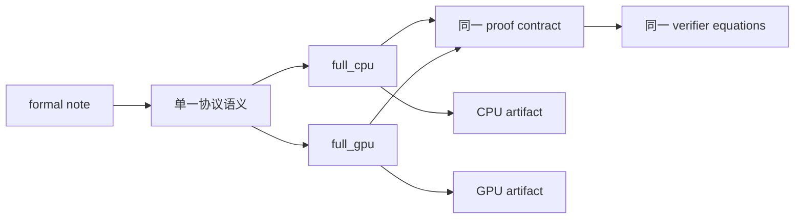
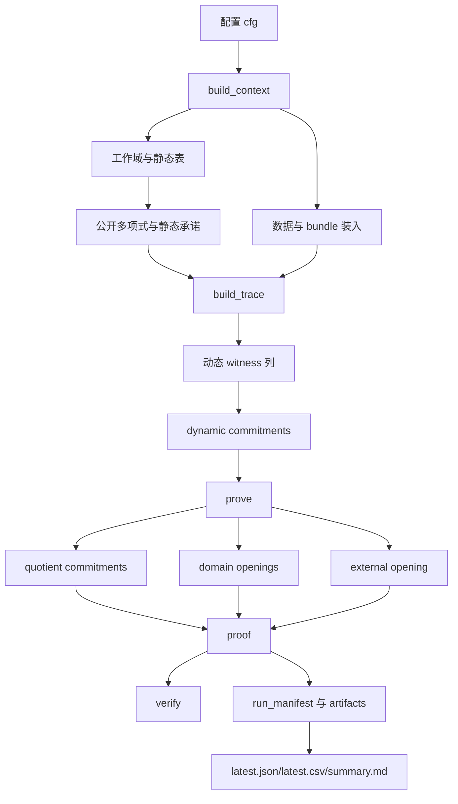
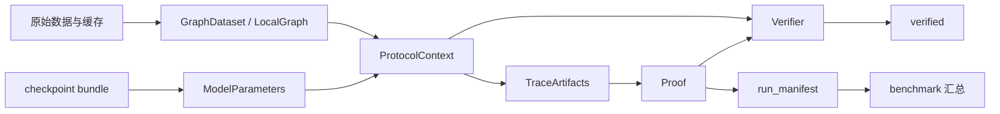
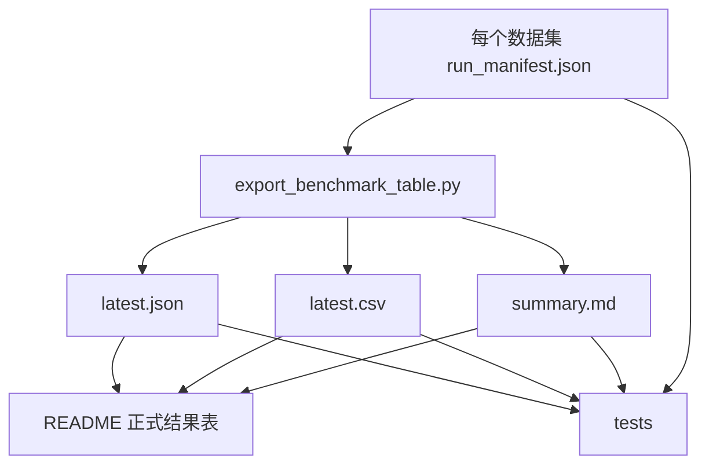

# 项目整体逻辑与方法流程

## 1. 项目目标与 formal 约束

### 1.1 项目目标

本项目的目标是把多层多头 `GAT` 模型的前向计算、查表约束、路由约束、状态机约束、承诺与验证流程整理成一条可运行、可验证、可导出 benchmark、可对齐论文写作的正式 `ZKML` 主线。

当前仓库的正式交付目标不是“继续探索协议”，而是：

- 保持一套已经收敛的 formal semantics。
- 用同一套 semantics 支撑 `full_cpu` 与 `full_gpu` 两个完整执行后端。
- 输出稳定的 proof、artifact、benchmark 真源与验证结果。
- 支撑论文写作、周报汇报和导师审阅。

### 1.2 唯一 formal 真源

本项目唯一 formal note 为：

- `GAT-ZKML-多层多头.md`

该文件是唯一语义真源，原因是：

- 协议含义只允许在一个地方被定义。
- proof schema、transcript 顺序、verifier equations、公开元数据契约都必须有唯一依据。
- README、tests、artifact、benchmark 只能围绕该 formal note 的已收敛语义组织，不能反向塑造协议。

### 1.3 本项目中绝对不能改的内容

基于 formal note 与当前实现，以下内容属于正式主线的硬边界：

- proof schema
- transcript 顺序
- serializer / parser 结构
- verifier equations
- `PublicMetadata` 契约
- `hidden_profile`
- `d_in_profile`
- `proof_size_bytes` 统计口径
- `latest.json` / `latest.csv` / `summary.md` / `run_manifest.json` 的正式 benchmark 口径

本总览文档只是实现说明，不是新的语义来源。

## 2. 项目整体架构

### 2.1 one formal logic 的含义

本仓库只保留一套 formal semantics。其含义不是“只有一套代码路径”，而是：

- prove / verify 的代数对象是一套。
- challenge 标签与吸收顺序是一套。
- quotient 恒等式是一套。
- KZG 承诺与 opening 关系是一套。
- proof object 与 artifact contract 是一套。

### 2.2 `full_cpu` 与 `full_gpu` 的角色

- `full_cpu`：默认完整执行后端，所有热点都可在 CPU 上完成。
- `full_gpu`：同一 formal semantics 下的完整执行后端，只把适合 `CUDA` 的 `Fr` 域热点迁移到 GPU。

二者共享：

- `src/protocol/*` 的证明与验证逻辑
- `include/gatzk/protocol/proof.hpp` 中的 proof / context 契约
- `src/crypto/kzg.cpp` 的承诺与 opening 方程
- `src/protocol/challenges.cpp` 的 transcript 重放逻辑

二者差异只属于执行层：

- barycentric 权重构造放在 CPU 还是 GPU
- weighted evaluation 是否走 GPU kernel
- lookup histogram 是否走 GPU
- packed evaluation backend 的具体实现路线

### 2.3 为什么这是“一套 formal semantics 的两个完整后端”

因为 `full_gpu` 没有引入第二套协议对象，也没有改变：

- challenge 名称
- opening 点集合
- dynamic commitment 标签
- quotient commitment 标签
- verifier 侧的重算公式

换句话说，`full_gpu` 只是“相同对象、相同顺序、相同方程”的另一种执行放置方式，不是第二协议。

## 3. 项目整体执行流程

### 3.1 输入对象

当前正式流程从以下输入开始：

- `configs/*.cfg` 中的正式配置
- `data/` 中的数据集原始文件
- `data/cache/` 中的标准化缓存
- `artifacts/checkpoints/*` 中的 checkpoint bundle

进入系统后的核心对象包括：

- config
- 图数据
- checkpoint bundle
- public metadata
- private witness

### 3.2 config 如何进入流程

`src/main.cpp` 读取命令行参数后调用：

- `gatzk::util::load_config`
- `gatzk::protocol::build_context`
- `gatzk::protocol::build_trace`
- `gatzk::protocol::prove`
- `gatzk::protocol::verify`

其中 config 直接决定：

- dataset 与缓存路径
- `hidden_profile`
- `d_in_profile`
- `K_out`
- `range_bits`
- `checkpoint_bundle`
- 导出目录与 benchmark 模式
- route2 执行开关

### 3.3 context 如何构建

`build_context` 在 `src/protocol/prover.cpp` 中完成以下工作：

- 加载数据集并标准化局部图
- 读取 checkpoint bundle 并检查 formal shape
- 创建各工作域
- 构造 `range / lrelu / elu / exp` 静态表
- 构造公开多项式与静态承诺
- 构造 `KZG` 所需 `SRS`

此阶段只构造静态上下文，不构造单次 proof 的动态 witness。

### 3.4 trace 如何构建

`build_trace` 在 `src/protocol/trace.cpp` 中负责：

- 调用 `model::forward_note_style` 或兼容路径获得前向中间量
- 把浮点中间量量化为 `FieldElement`
- 物化 feature lookup、activation lookup、range lookup、exp lookup
- 物化 `route`、`PSQ`、`state machine`、`zkMaP`
- 生成 dynamic commitments
- 在固定 transcript 顺序下记录 challenge

### 3.5 proof 如何生成

`prove` 在 `src/protocol/prover.cpp` 中负责：

- 重放 trace commitments 对应的 transcript
- 构造 quotient evaluations 与 quotient commitments
- 为各域构造 domain opening bundle
- 构造 external opening
- 组装 `Proof`

### 3.6 verify 如何完成

`verify` 在 `src/protocol/verifier.cpp` 中负责：

- 检查 `PublicMetadata`
- 检查 block 顺序
- 重放 transcript 并比对挑战
- 校验各域的 batch opening witness
- 重算 quotient 并比对打开值
- 检查 external evaluation 与 witness scalar 的绑定关系

### 3.7 artifact 与 benchmark 如何导出

正式导出分两层：

- 单次运行导出到 `runs/<dataset>/<mode>/...`
- benchmark 汇总导出到 `runs/benchmarks/` 或 `runs/benchmarks/cuda_formal/`

单次运行产物包括：

- `run_manifest.json`
- `benchmark.txt`
- `metadata.txt`
- `commitment_order.txt`
- `proof_block_order.txt`
- `challenges.txt`

汇总产物包括：

- `latest.json`
- `latest.csv`
- `summary.md`

### 3.8 数据流 / 对象流

## 4. 方法使用与算法设计

### 4.1 分层方法

项目中的关键方法按层次大致分为：

- algebra 层：工作域、barycentric 权重、evaluation backend、向量算子
- crypto 层：曲线运算、`KZG` 承诺、transcript
- model 层：`GAT` 参数、参考前向、层级 shape 校验
- protocol 层：trace、lookup、route、`PSQ`、quotient、prove、verify
- util 层：config、logging、route2

### 4.2 各方法解决的问题

- `lookup`：把 `feat / lrelu / elu / range / exp` 约束转成 LogUp 累加关系
- `route`：把节点级对象与边级对象之间的广播和回收关系写成可验证轨迹
- `PSQ`：表达 softmax 分组前缀和链
- `state machine`：表达 `c_max`、组边界等状态递推
- `selector`：限制有效区域与 padding 区域
- `cache`：复用静态上下文、域权重、部分 trace 小对象

### 4.3 为什么采用这种分层

因为本项目需要同时满足：

- formal semantics 唯一
- CPU / GPU 后端共存
- prove / verify 共享同一挑战真源
- benchmark 可以独立导出

如果把执行优化直接混进协议层，会破坏“同一语义、不同执行策略”的边界。

### 4.4 `PSQ`、`state machine`、`lookup`、`route`、`selector`、`cache` 的角色

- `PSQ`：按目标节点分组积累 `u + lambda * v_hat`
- `state machine`：对 `q_new` 分界的组内状态做递推
- `lookup`：把连续值映射到静态表并验证成员关系
- `route`：把节点对象展开到边，再把边对象折回节点
- `selector`：确保有效区与 padding 区分明
- `cache`：只复用执行层等价对象，不复用 proof 实例特有对象

## 5. 证明系统说明

### 5.1 当前实现使用的证明系统

当前仓库直接实现的是基于 `KZG` 的多项式承诺证明流程。当前仓库直接体现到：

- `src/crypto/kzg.cpp`
- `include/gatzk/crypto/kzg.hpp`
- `Proof` 中的 commitment / opening / witness 结构

### 5.2 `KZG` 在哪里使用

`KZG` 使用位置包括：

- 公开多项式承诺
- 静态表承诺
- dynamic witness commitment
- quotient commitment
- domain opening witness
- external opening witness

### 5.3 polynomial commitment 在哪里体现

在实现上主要体现为：

- `crypto::Commitment`
- `crypto::KZG::commit`
- `crypto::KZG::open_batch`
- `crypto::KZG::verify_batch`

### 5.4 transcript 与 challenge

transcript 由以下文件共同维护：

- `src/crypto/transcript.cpp`
- `src/protocol/challenges.cpp`
- `src/protocol/trace.cpp`
- `src/protocol/verifier.cpp`

关键约束是：

- 吸收顺序固定
- 标签命名固定
- prove / verify 必须重放出同一 challenge map

### 5.5 verifier 主要检查对象

verifier 主要检查：

- `PublicMetadata`
- dynamic commitment 顺序
- quotient commitment 顺序
- 各域 batch opening
- quotient 重算值
- external evaluation 关系
- output bias 与 output average 关系

### 5.6 当前仓库未直接体现的边界

以下学术层结论当前仓库未直接以形式化证明文本给出：

- 完整的零知识安全性证明文本
- 更高层的知识提取器描述
- 更强的组合安全性定理

当前仓库直接体现的是“可运行的承诺、opening、重放与验证检查实现”，而不是完整论文级安全证明全文。

## 6. 数据、隐私与公开信息边界

### 6.1 哪些对象属于 private / witness

当前实现里属于 witness 侧的对象主要包括：

- 动态 trace 列
- 中间激活
- 注意力分数
- `route` / `PSQ` / `state machine` / `zkMaP` 产生的辅助列
- 输出前的各层聚合结果

### 6.2 哪些对象属于 public

当前 proof 公开面直接体现为：

- `PublicMetadata`
- dynamic commitments
- quotient commitments
- domain opening 中的打开点与打开值
- external evaluations
- witness scalars

### 6.3 当前仓库如何体现“约束但不直接泄露”

当前实现中，原始 witness 不以“整列公开”的形式暴露，而是：

- 先变成 commitment
- 再在 verifier 指定点上打开
- verifier 只检查必要的 opening 值与 quotient 等式

因此 raw witness 不会以完整矩阵或完整列的形式直接进入公开 metadata。

### 6.4 需要明确的边界

当前仓库中未直接体现：

- 对数据文件与 checkpoint 文件的外部访问控制策略
- “原始数据永不以任何形式离开本地环境”的系统级安全证明

当前仓库直接体现的是 proof 接口的公开边界，而不是数据分发制度本身。

## 7. 安全性、公平性、一致性与可验证性

### 7.1 安全性与可验证性来自哪里

当前实现中的安全与可验证性主要来自：

- `KZG` 承诺与 opening 检查
- transcript 重放
- quotient 恒等式重算
- `PublicMetadata` 契约比对
- proof block 顺序比对

### 7.2 为什么别人可以信这个 proof

因为 verifier 不依赖 prover 自报，而是自己重算：

- challenges
- quotient
- opening 点
- output 平均与 bias 关系
- bundle 内的承诺标签顺序

### 7.3 哪些机制约束作弊或后端分叉

- `proof_block_order()` 固定 proof block 顺序
- `dynamic_commitment_labels()` 固定动态承诺顺序
- `quotient_commitment_labels()` 固定 quotient 顺序
- `replay_challenges()` 固定 challenge 派生
- CPU / GPU 共用同一 `ProtocolContext` / `Proof` 契约

### 7.4 proof contract、`hidden_profile`、`d_in_profile`、artifact contract

这些约束在以下位置直接体现：

- `PublicMetadata`
- `tests/test_main.cpp`
- `run_manifest.json`
- README 正式结果表

它们共同保证：

- proof 大小口径不乱
- 形状元数据不乱
- artifact 与 benchmark 汇总不乱

### 7.5 CPU / GPU 共用同一 formal semantics 对公平比较的意义

它保证 CPU / GPU 比较是“同一 proof contract 下的执行时间比较”，不是“两套协议各自挑自己有利口径”的比较。

## 8. 数据处理与数值表示

### 8.1 浮点如何进入系统

浮点来源主要有两类：

- checkpoint bundle 中的模型参数
- model 参考前向中的中间浮点结果

### 8.2 如何量化

当前代码中直接体现的量化规则是：

- 乘以 `16`
- 正数 `+0.5`、负数 `-0.5` 后取整
- 用 `FieldElement::from_signed` 进入域

这个规则在以下位置直接体现：

- `src/protocol/prover.cpp`
- `src/protocol/trace.cpp`
- `include/gatzk/algebra/field.hpp`

### 8.3 `range_bits`、`lookup` 与表化

`range_bits` 会决定 range 表规模，相关静态表包括：

- `range`
- `lrelu`
- `elu`
- `exp`

这些表在 context 阶段构造，在 trace / quotient / verifier 阶段被共同使用。

### 8.4 signed field semantics

带符号语义不是靠“额外符号位对象”表达，而是靠：

- `FieldElement::from_signed`
- 统一的量化规则
- range / exp / activation lookup 约束

### 8.5 哪些位于前处理层，哪些位于协议层

前处理层：

- 数据集标准化
- bundle 读取
- 浮点参考前向
- 量化前的矩阵与向量组织

协议层：

- 量化后的 witness 列
- lookup 查询值
- polynomial / commitment / opening
- quotient 约束

### 8.6 为什么这些处理不改变 formal semantics

因为 formal semantics 约束的是“进入证明系统后的离散对象与代数关系”。当前实现中的量化、查表和折叠，都是为了把浮点参考前向变成同一 formal 对象，并没有在 prove / verify 阶段引入第二套解释。

### 8.7 需要明确的边界

若问“原始浮点数学模型与离散证明对象之间的全部理论误差界”，当前仓库未直接完整给出。当前实现只直接体现：

- 固定量化规则
- 固定静态表
- 固定 proof 约束对象

更强的数值分析结论需要论文正文补充。

## 9. 热路径与性能压缩逻辑

### 9.1 当前总体热点判断

根据 README、`run_manifest.json` 与 `docs/热点优化方法与处理逻辑.md`，当前总体结论是：

- verify 已不是第一主矛盾
- 主矛盾主要在 `commitment_time_ms` 与 `prove_time_ms`
- 大图重点是 `ppi` 与 `ogbn-arxiv`

### 9.2 各类热点与代码位置

- `trace_generation`：`src/protocol/trace.cpp`
- `witness_materialization`：`src/protocol/trace.cpp` 与 `src/protocol/prover.cpp`
- `dynamic commitment`：`src/protocol/trace.cpp`、`src/crypto/kzg.cpp`
- `lookup`：`src/protocol/lookup.cpp`、`src/protocol/trace.cpp`
- `route`：`src/protocol/trace.cpp`
- `PSQ` / `state machine`：`src/protocol/psq.cpp`、`src/protocol/trace.cpp`
- `dynamic_domain_convert` 与 barycentric 权重：`src/algebra/polynomial.cpp`、`src/algebra/eval_backend.cpp`、`src/crypto/kzg.cpp`
- `CUDA size-aware` 路由：`src/algebra/vector_ops.cpp`、`src/algebra/cuda_backend.cu`

### 9.3 当前时间压缩方式

当前正式代码中直接保留的执行层压缩方式包括：

- 静态 context cache
- 域权重缓存
- packed evaluation backend
- `trace_layout_upgrade`
- `full_gpu` 的 size-aware 热点路由
- 单图下 `c_max / PSQ` 状态向量缓存

这些方式都不改变：

- transcript
- proof schema
- verifier equations
- artifact contract

### 9.4 `PPI`

当前文档与 manifest 共同表明，`PPI` 的主要压力仍在：

- `trace_generation_ms`
- `commit_dynamic_ms`

`PPI` 是 `multi_graph_batch`，因此很多只对单图成立的方法不能直接外推。

### 9.5 `ogbn-arxiv`

`ogbn-arxiv` 是单图正式路径，当前主要压力在：

- `trace_generation_ms`
- `prove_time_ms`
- 大域 opening / evaluation 热点

`context_build_ms` 很大，但它不是 README 四项正式指标之一。

### 9.6 verify

当前 verify 已经不是主瓶颈。仓库中对 verify 的主要执行层优化集中在：

- batch opening
- verifier 侧 evaluation memoization
- public evaluation backend

### 9.7 commitment 与 prove

当前正式 benchmark 里，最需要关注的是：

- `commit_dynamic_ms`
- `trace_generation_ms`
- domain opening 相关求值
- quotient 构造

### 9.8 `shared tau evaluation` 与 `dynamic_domain_convert`

当前代码直接体现了同域权重与求值缓存复用。若问“更强的跨运行共享 tau evaluation retained 方法”，当前仓库中未直接保留为正式主线；这部分只在 `docs/热点优化方法与处理逻辑.md` 中作为经验资产被记录。

### 9.9 `CUDA size-aware` 路由

当前正式代码直接体现了：

- `should_use_cuda_barycentric_weights`
- `should_use_cuda_weighted_evaluation`
- `should_use_cuda_lookup_histogram`

这些函数只决定热点是否送入 GPU，不改变证明对象。

## 10. retained / reverted 方法资产

### 10.1 已保留方法

当前代码与 `docs/热点优化方法与处理逻辑.md` 共同表明，当前正式主线保留的方法包括：

- 单图 `q_new` 相关状态递推快捷路径
- 单图 `c_max / PSQ` 状态向量缓存
- `full_gpu` 的统一 size-aware 热点路由
- trace-layout 下对部分矩阵 witness 的 commitment-only 处理

这些方法的共同点是：

- 只改变执行层
- 不改变 transcript、proof schema、verifier equations
- 已经融入正式主线代码

### 10.2 已回退但仍有价值的方法

根据 `docs/热点优化方法与处理逻辑.md`，以下方法被记录为有价值经验，但未保留在当前正式主线：

- PPI 多图 `dst group` 直接前缀状态构造
- PPI 多图 `shared tau evaluation cache`
- `ogbn-arxiv` 单图 `binding trace` warm cache

这些方法的仓库边界是：

- 当前代码主线未直接启用
- 当前仓库只把它们保留为实现经验
- 它们不应再次混入正式 benchmark 真源

### 10.3 对论文的价值

这些 retained / reverted 资产适合作为论文中的“系统实现经验”与“工程取舍”章节素材，但不应再次包装成当前正式主线仍在运行的方法。

## 11. truth-source 与正式结果体系

### 11.1 accepted truth 是什么

当前正式结果体系以以下对象共同构成 accepted truth：

- `README.md`
- `runs/benchmarks/latest.json`
- `runs/benchmarks/latest.csv`
- `runs/benchmarks/summary.md`
- `runs/benchmarks/cuda_formal/latest.json`
- `runs/benchmarks/cuda_formal/latest.csv`
- `runs/benchmarks/cuda_formal/summary.md`
- 各数据集 `run_manifest.json`
- `tests/test_main.cpp`

### 11.2 为什么这些文件必须一致

因为它们分别承担不同对外角色：

- README：对人汇报
- latest.json：对程序读取
- latest.csv：对表格处理
- summary.md：对 benchmark 汇总阅读
- run_manifest.json：对单次运行追溯
- tests：对一致性自动检查

一旦分叉，就会出现：

- README 说的是一套结果
- artifact 记的是另一套结果
- tests 又对着第三套口径检查

这会直接破坏正式提交可信度。

### 11.3 truth-source 关系图

### 11.4 为什么实验结果不能覆盖正式真源

因为正式 benchmark 只接受：

- full-dataset
- warm
- verified
- 与当前 proof contract 一致

任何实验性结果只要未满足这四条，就不能覆盖正式真源。

## 12. 目录结构与模块职责

### 12.1 `include/gatzk`

作用：

- 对外暴露 algebra / crypto / model / protocol / util 的正式接口
- 定义 `ProtocolContext`、`TraceArtifacts`、`Proof` 等主契约
- 是代码阅读与论文对象命名的第一入口

### 12.2 `src`

作用：

- 存放全部正式实现
- 包括 proving、verifying、trace、KZG、route2、数据加载和模型前向

### 12.3 `tests`

作用：

- formal suite
- 真源一致性检查
- proof contract 回归
- benchmark 主表回归

### 12.4 `scripts`

作用：

- 数据准备
- checkpoint / bundle 导出
- benchmark 汇总导出

它们是正式主线的辅助脚本，不是第二协议实现。

### 12.5 `configs`

作用：

- 固定五个正式数据集的运行配置
- 把 dataset、shape、range_bits、bundle 路径、batching 规则钉死

### 12.6 `artifacts`

作用：

- 保存 checkpoint bundle
- 是正式参数来源

### 12.7 `data`

作用：

- 保存数据集原始文件与缓存
- 是 `GraphDataset / LocalGraph` 的上游输入

### 12.8 `runs`

作用：

- 保存正式 benchmark 汇总
- 保存每个正式数据集 run 的 manifest 与辅助文本
- 保存 formal suite 日志

### 12.9 `docs`

作用：

- 保存实现经验文档
- 当前主要是 `热点优化方法与处理逻辑.md`

### 12.10 `reference`

作用：

- 保存仓库内部化后的参考材料
- 当前用于保留 `ogbn-arxiv` 相关参考模板

## 13. 当前项目状态与后续方向

### 13.1 当前 accepted baseline

#### CPU

| 数据集 | commitment_time_ms | prove_time_ms | verify_time_ms | proof_size_bytes |
| --- | ---: | ---: | ---: | ---: |
| Cora | 262.605 | 1174.454 | 153.686 | 90755 |
| Citeseer | 445.371 | 1327.556 | 153.984 | 90763 |
| Pubmed | 2941.120 | 5564.076 | 175.585 | 90760 |
| PPI | 3510.734 | 7133.975 | 426.190 | 21360 |
| ogbn-arxiv | 17569.742 | 65329.058 | 398.058 | 21361 |

#### GPU

| 数据集 | commitment_time_ms | prove_time_ms | verify_time_ms | proof_size_bytes |
| --- | ---: | ---: | ---: | ---: |
| Cora | 287.779 | 1237.908 | 152.254 | 90755 |
| Citeseer | 472.522 | 1354.367 | 153.856 | 90763 |
| Pubmed | 2998.093 | 5671.482 | 172.095 | 90760 |
| PPI | 3572.921 | 7136.396 | 450.268 | 21360 |
| ogbn-arxiv | 17541.068 | 65736.261 | 431.560 | 21361 |

### 13.2 当前正式主线状态

当前正式主线已经达到：

- one formal logic 已收敛
- `full_cpu` 与 `full_gpu` 双后端并存
- proof contract 稳定
- benchmark 真源稳定
- CPU / GPU formal suite 可作为封板依据

### 13.3 当前仍然存在的瓶颈

最值得继续关注的仍然是：

- `ppi` / `ogbn-arxiv` 的 `commitment_time_ms`
- `ppi` / `ogbn-arxiv` 的 `prove_time_ms`
- trace generation
- dynamic commitment

### 13.4 后续最值得继续优化的方向

在不改变 formal semantics 的前提下，后续最值得继续研究的是：

- 大图 trace 物化成本
- dynamic commitment 前的共享求值与布局
- verifier 之外的 proving 热点
- `full_gpu` 内部热点放置策略

### 13.5 不属于本轮整理范围的方向

以下方向仍值得研究，但不属于本轮整理范围：

- 新的协议语义
- 新的 proof schema
- 新的 retained patch 试验轮
- 新的 benchmark 口径

### 13.6 最终定位

当前仓库应被理解为：

- 一份正式提交版仓库
- 一份论文实现底稿
- 一份 benchmark 真源仓库
- 一份可以直接向导师汇报整体流程的实现说明

但它不是新的 formal note，也不是新的协议设计文档。
